# 🛡️ Agent de tri SOC — Édition LangGraph

**Bejaoui Bechir** · projet de démonstration doctoral

**[🇬🇧 Read in English](README.md)**

Un système de tri d'alertes pour **Centre des Opérations de Sécurité (SOC)**,
composé de cinq agents. Quatre agents logiciels communiquent via le
**protocole A2A** (Agent2Agent, Linux Foundation) en JSON-RPC, **LangGraph**
les orchestre, et le cinquième agent est un humain qui approuve ou rejette à
une barrière qui met le graphe en pause en pleine exécution.

Construit et mesuré sur un corpus réel de **738 alertes Wazuh**.

> **La règle autour de laquelle tout le système est bâti :**
> les règles et les outils **décident** ; le modèle de langage ne fait
> qu'**écrire de la prose**. Chaque rapport se termine par « Aucun verdict
> de ce rapport n'a été produit par un modèle de langage. » — et cette
> phrase est testée, pas affirmée.

---

## ▶️ Lancer la démonstration

**Fenêtre 1 — l'hôte des agents.** À laisser ouverte :

```cmd
cd C:\Users\RONIN\Desktop\soc-triage-langgraph
.venv\Scripts\activate
python run_agents.py
```

**Fenêtre 2 — l'exécution :**

```cmd
cd C:\Users\RONIN\Desktop\soc-triage-langgraph
.venv\Scripts\activate
set SOC_A2A_MODE=1
python run_graph.py demo
```

**Fenêtre 3 — l'interface :**

```cmd
cd C:\Users\RONIN\Desktop\soc-triage-langgraph
.venv\Scripts\activate
set SOC_A2A_MODE=1
streamlit run app.py
```

Installation complète, clés et dépannage : [Démarrage rapide](#démarrage-rapide).

---

## Sommaire

| | |
|---|---|
| [Guide visuel](#guide-visuel) | le système entier en sept schémas |
| [Le problème traité](#le-problème-traité) | pourquoi le tri SOC est difficile |
| [Fonctionnement](#fonctionnement) | les cinq agents et le graphe |
| [Une alerte, de bout en bout](#une-alerte-de-bout-en-bout) | ce qui se passe réellement |
| [Les résultats principaux](#les-résultats-principaux) | les chiffres qui comptent |
| [Démarrage rapide](#démarrage-rapide) | installer et exécuter |
| [Comment la décision est prise](#comment-la-décision-est-prise) | la barrière d'escalade |
| [Les 23 constats](#les-23-constats) | tout ce qui a été mesuré |
| [Affirmations retirées](#affirmations-retirées) | ce qui a été rétracté |
| [Ce que ce projet n'est pas](#ce-que-ce-projet-nest-pas) | limites assumées |
| [Carte des fichiers](#carte-des-fichiers) | où se trouve quoi |

---

## Guide visuel

Sept images qui expliquent le système entier avant même de lire une ligne de
prose. Toutes se dessinent d'elles-mêmes sur GitHub — aucun fichier image à
télécharger.

### 1 · La règle fondatrice du système

Deux zones. Celle de gauche a le droit de **décider** ; celle de droite n'a
le droit que de **décrire**. Aucune flèche ne revient de la droite vers la
gauche, et cette absence constitue toute la conception.

```mermaid
flowchart LR
    subgraph DECIDE["🔒 AUTORISÉ À DÉCIDER — 500 exécutions, 1 résultat"]
        direction TB
        R1["severity.py<br/>règles de tri"]
        R2["mitre.py<br/>correspondance ATT&CK"]
        R3["threat_intel.py<br/>réputation"]
        R4["history.py<br/>requêtes SQLite"]
        R5["forensics.py<br/>détection de mouvement"]
        R6["reporter.py<br/>la barrière d'escalade"]
    end
    subgraph DESCRIBE["✍️ AUTORISÉ SEULEMENT À DÉCRIRE — 16 exécutions, 3 résultats"]
        direction TB
        L1["hypothèse du chasseur<br/>prose"]
        L2["récit forensique<br/>prose"]
        L3["priorité de confinement<br/>une étiquette, jamais un verdict"]
    end
    DECIDE -->|"des faits déjà décidés"| DESCRIBE
    DESCRIBE -->|"des phrases, rien d'autre"| OUT["📄 rapport d'incident"]
    DECIDE ==>|"chaque verdict, chaque indicateur, chaque nombre"| OUT
    style DECIDE fill:#e7f5ff,stroke:#1971c2
    style DESCRIBE fill:#fff9db,stroke:#f08c00
```

Le modèle lit des faits et écrit des phrases. Il ne renvoie jamais un nombre
vers la couche décisionnelle. Le **constat 21** raconte l'unique fois où ce
n'était pas vrai, et ce que sa mesure a coûté.

### 2 · Comment un enregistrement brut devient une alerte

Deux tiers du corpus arrivent déguisés en journal de pare-feu. Cette chaîne
de traitement est la raison pour laquelle le système voit 99,6 % des données
au lieu de 36,9 %.

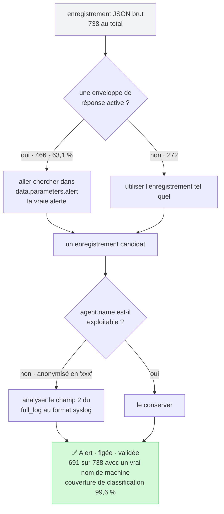

Rien n'est inventé ici. Chaque champ récupéré était déjà dans le fichier —
les **constats 2, 4 et 9** portent tous sur des preuves présentes mais non
lues.

### 3 · La vie d'une exécution, pause incluse

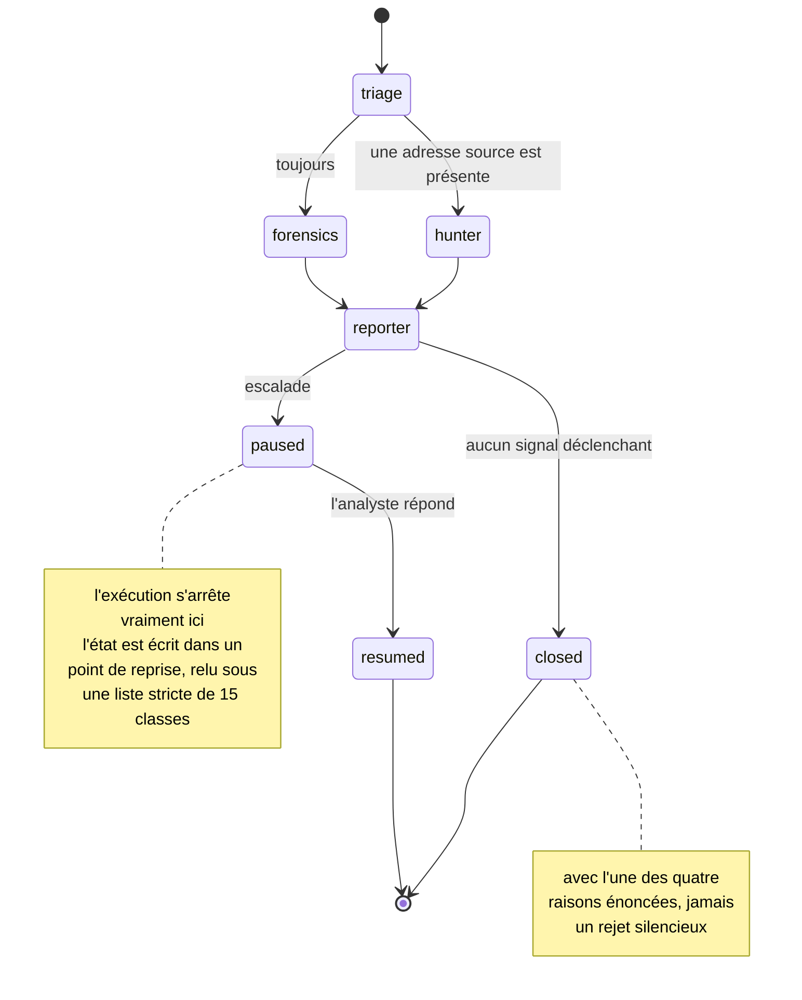

`chasseur` et `forensique` quittent `tri` dans la **même étape**, et non l'un
après l'autre. `rapporteur` attend les deux, et s'exécute même quand le
`chasseur` a été ignoré — une jonction qui échoue silencieusement lorsqu'elle
est fausse, d'où son test dédié.

### 4 · 738 alertes en entrée, 6 en sortie

Chaque alerte aboutit dans exactement l'une des cinq cases, et les cinq
totalisent 738.

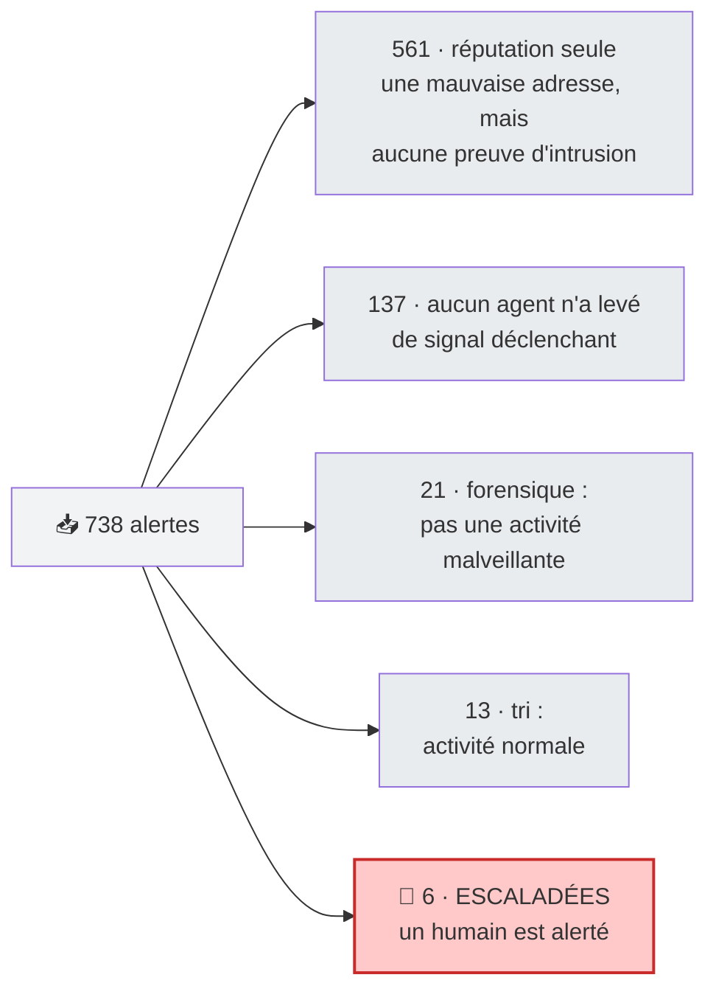

La première version de cette barrière plaçait **567** alertes dans la case
rouge. Les 561 concernées portaient une adresse connue comme malveillante et
rien d'autre. Une mauvaise adresse qui frappe, c'est Internet ; une mauvaise
adresse qui **est entrée**, c'est un incident — **constat 19**.

### 5 · Pourquoi une fenêtre temporelle n'est pas un incident

L'erreur la plus coûteuse du projet. Une fenêtre de 60 minutes autour d'une
alerte contient en moyenne **72,2 % d'événements appartenant à quelqu'un
d'autre**.

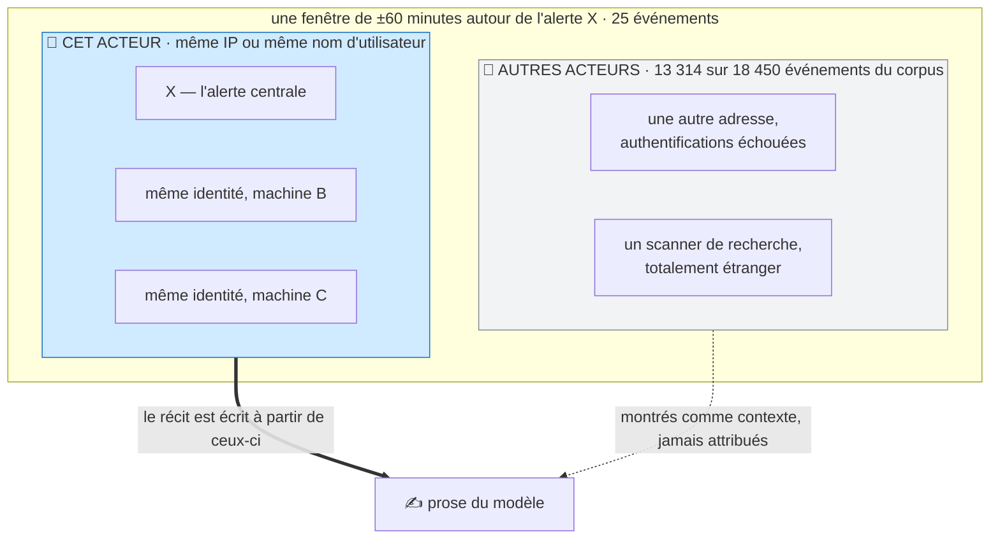

Avant cette séparation, le modèle a écrit un récit parfaitement fidèle qui
imputait à son sujet trois authentifications échouées appartenant à un
**autre attaquant** présent dans la même heure. Ce n'était pas la prose le
problème, mais les preuves — **constat 14**.

### 6 · Les couches, et ce qui dépend de quoi

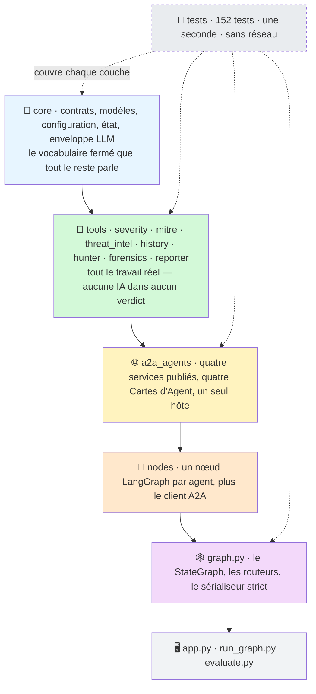

Chaque couche ne connaît que celle juste en dessous. `tools/` n'a jamais
entendu parler d'A2A, et c'est pourquoi `SOC_A2A_MODE=0` et
`SOC_A2A_MODE=1` produisent des résultats identiques — **constat 16**.

### 7 · Ce qui se passe réellement dans un appel A2A

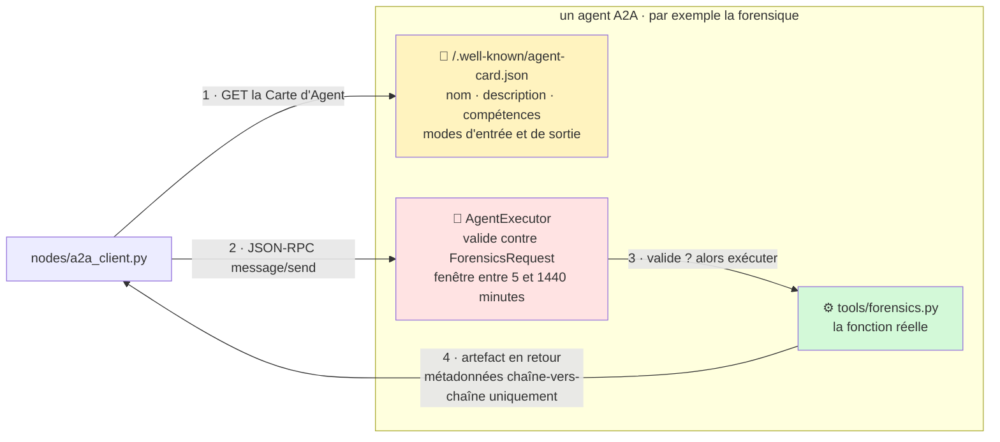

L'étape 2 est celle qui coûte **444 ms** — environ 20 % d'une exécution à
deux agents (**constat 7**). L'étape 3 justifie ce coût : une frontière qui
rejette une requête mal formée est une vraie frontière, et l'agent pourrait
être déplacé sur une autre machine en changeant une adresse. L'étape 1 n'est
volontairement pas mise en cache, pour que le chiffre mesuré reflète une
implémentation directe et non optimisée.

---

## Le problème traité

Un **Centre des Opérations de Sécurité (SOC)** est l'équipe qui surveille
les journaux d'une organisation à la recherche de signes d'attaque. Son
logiciel de supervision — ici **Wazuh** — émet une *alerte* dès qu'un
événement correspond à une règle : une authentification échouée, une requête
web suspecte, un fichier système modifié.

La difficulté est le volume. Un parc de taille moyenne produit des milliers
d'alertes par jour, et l'immense majorité est du bruit : Internet qui frappe
à des portes qui restent fermées. Un analyste humain doit examiner chacune
et décider *clôturer* ou *investiguer*. Cette décision s'appelle le **tri**,
et la rater dans un sens comme dans l'autre coûte cher :

- trop clôturer → une intrusion réelle passe inaperçue
- trop escalader → les analystes cessent de lire la file, et une intrusion
  réelle passe inaperçue de toute façon

Ce projet demande si un **groupe d'agents spécialisés** fait ce travail mieux
qu'un classificateur unique, et si un **modèle de langage** a quoi que ce
soit à faire dans cette décision. Les deux questions reçoivent une réponse
mesurée, non argumentée.

### Ce que contient réellement le corpus

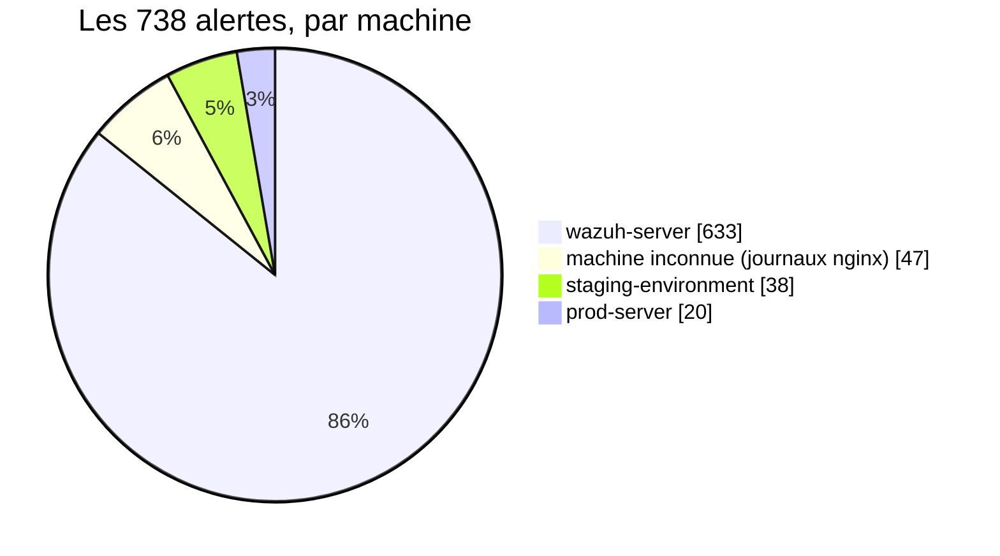

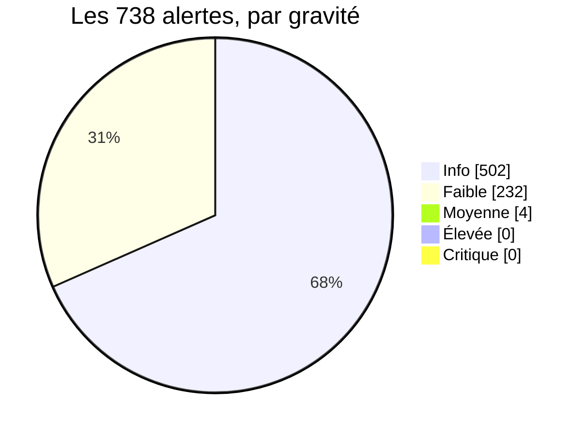

Deux faits sautent aux yeux, et tous deux ont façonné chaque décision de
conception qui suit :

1. **Rien n'est grave.** Pas une seule alerte n'atteint la gravité Élevée.
   Un système qui escalade sur la seule gravité des règles n'escaladerait
   *jamais rien*.
2. **C'est une seule machine.** 85,8 % des alertes proviennent d'un unique
   capteur soumis à un balayage permanent depuis Internet.

---

## Fonctionnement

### Les cinq agents

| | agent | la question à laquelle il répond | ce qu'il possède |
|---|---|---|---|
| 1 | **tri** | *De quel type d'alerte s'agit-il, prise isolément ?* | rien — une fonction pure |
| 2 | **chasseur** | *Cette adresse est-elle connue comme malveillante, et quelle technique ATT&CK ?* | rien + renseignement externe |
| 3 | **forensique** | *Que s'est-il passé autour, et par qui ?* | **un historique SQLite des alertes** |
| 4 | **rapporteur** | *Qu'est-ce que tout cela donne, et un humain doit-il le voir ?* | rien |
| 5 | **l'humain** | *Agir, ou clôturer ?* | la décision finale |

Chacun des quatre agents logiciels est un véritable service A2A : il publie
une **Carte d'Agent** à `/.well-known/agent-card.json` décrivant ce qu'il
fait, valide tout ce qui arrive à sa porte contre un contrat, et pourrait
être déplacé sur une autre machine en changeant une adresse.

### Le graphe d'orchestration

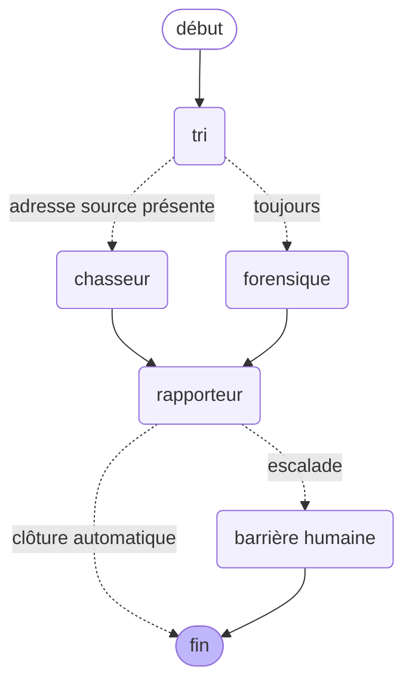

Les traits pleins sont des arêtes fixes ; les pointillés sont
**conditionnels**. Trois points méritent qu'on s'y arrête :

- **`chasseur` et `forensique` s'exécutent dans la même étape.** Ils
  répondent à des questions différentes et aucun n'a besoin de la réponse de
  l'autre. La trace des points de reprise l'enregistre littéralement :
  `next -> ('hunter', 'forensics')`.
- **Le chasseur est ignoré en l'absence d'adresse source.** Rien à
  interroger. Le rapporteur s'exécute quand même — une branche ignorée ne
  doit pas bloquer la jonction, et c'est un comportement qui échoue
  *silencieusement* lorsqu'il est faux, donc il est testé explicitement.
- **La barrière n'apparaît que si l'alerte a réellement été escaladée.** Une
  barrière qui apparaît toujours n'est pas une barrière, c'est une fenêtre de
  confirmation.

---

## Une alerte, de bout en bout

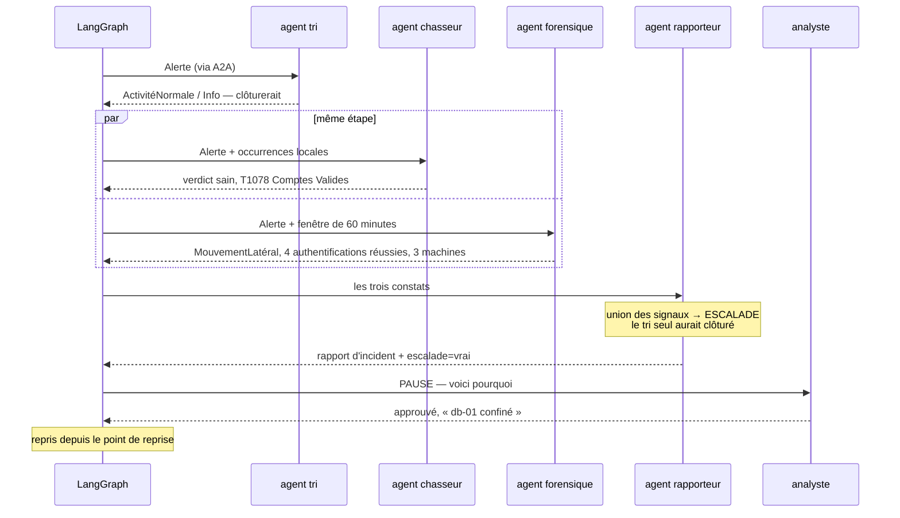

Cet exemple est réel. Le tri qualifie l'alerte d'**activité normale** — et le
tri n'a pas tort : `PAM: Login session opened.` au niveau Wazuh 3 est
l'événement le plus banal d'un parc Linux. La forensique, en regardant le
*voisinage* de cette même alerte, constate que la même identité s'authentifie
avec succès sur trois machines en douze minutes.

**Aucun des deux agents n'a tort. Ils répondent à des questions
différentes.** Ce désaccord constitue l'argument central d'une conception
multi-agents, et le rapport l'énonce au lieu de le moyenner.

### L'interface


Cinq couches, chacune montrant un élément mesuré par le projet : la trace
d'audit en direct, les conclusions de chaque agent côte à côte, les preuves
derrière chaque affirmation, la barrière humaine, et le rapport d'incident.

---

## Les résultats principaux

### La barrière d'escalade

Combien des 738 alertes sont envoyées à un humain ?

```
première barrière (réputation escalade)  ███████████████░░░░░  567   76,8 %
tri seul                                 ░░░░░░░░░░░░░░░░░░░░    0    0,0 %
les trois agents (version livrée)        ░░░░░░░░░░░░░░░░░░░░    6    0,8 %
```

La première barrière était un **échec** : envoyer 76,8 % des alertes à un
humain, c'est la fatigue d'alertes que le système existe pour supprimer,
déplacée d'un cran vers la droite. La cause était conceptuelle — elle lisait
la *réputation* comme de l'*impact*. Une adresse connue comme malveillante
qui frappe à une porte, c'est Internet ; une adresse malveillante qui **est
entrée**, c'est un incident.

La barrière corrigée escalade 6 alertes, et **les 6 sont des alertes que le
tri seul aurait clôturées.** Elle détecte toujours 5/5 d'une intrusion
confirmée et 0/6 des deux scénarios de pulvérisation conçus pour la tromper.

### Où partent le temps et l'argent

```
appel A2A (par agent)        ████████████████████  445,1 ms
appel en processus           ░░░░░░░░░░░░░░░░░░░░    1,4 ms   (318× plus rapide)

un appel au modèle           ~657 jetons   ≈ 0,00013 $
l'évaluation complète        68 appels     ≈ 0,01 $
```

A2A a un coût réel, payé délibérément pour une capacité publiée, une
frontière validée et la remplaçabilité.

### Quelle reproductibilité ?

```
règles déterministes   500 exécutions  →  1 résultat distinct   ██████████ 100 %
le modèle de langage    16 exécutions  →  3 résultats distincts ████░░░░░░  81 % identiques
```

Cette séparation est toute l'architecture. La couche reproductible produit
chaque nombre sur lequel quelqu'un agit ; la couche variable produit des
phrases.

---

## Démarrage rapide

### Le chemin le plus court qui fonctionne

Aucune clé, aucun serveur, une seule fenêtre. C'est la version à utiliser
trente secondes avant une démonstration.

```cmd
git clone https://github.com/bechir08933891/soc-triage-langgraph.git
cd soc-triage-langgraph
pip install -r requirements.txt
set SOC_A2A_MODE=0
python run_graph.py demo
```

`demo` est un incident de mouvement latéral synthétique et étiqueté, intégré
au projet : cela fonctionne donc **avant** le téléchargement du jeu de données
et **sans** aucune clé d'API. Vous devez voir les cinq agents rendre compte
l'un après l'autre, la barrière décider **ESCALADE**, et l'exécution se mettre
en pause à la barrière humaine.

> **`set SOC_A2A_MODE=0` n'est pas facultatif ici.** `core/config.py` donne à
> `A2A_MODE` la valeur par défaut **vrai** : sans cette ligne, l'exécution
> cherche un serveur A2A qui ne tourne pas et échoue sur une erreur de
> connexion. Ne l'omettez que si `python run_agents.py` est déjà ouvert dans
> une autre fenêtre.

Tout ce qui suit est l'installation complète.

### 1 · Récupérer le code et un environnement propre

```cmd
git clone https://github.com/bechir08933891/soc-triage-langgraph.git
cd soc-triage-langgraph
python -m venv .venv
```

Puis l'activer :

| système | commande |
|---|---|
| **Windows, cmd** | `.venv\Scripts\activate` |
| Windows, PowerShell | `.venv\Scripts\Activate.ps1` |
| macOS / Linux | `source .venv/bin/activate` |

```cmd
pip install -r requirements.txt
```

**Ce que vous devez voir :** votre invite commence désormais par `(.venv)`, et
`python --version` indique 3.13.x. Aucun GPU n'est utilisé ; le projet entier
tourne confortablement avec 8 Go de RAM.

### 2 · Récupérer le jeu de données

Le corpus de 738 enregistrements n'est **pas** dans ce dépôt — il se
télécharge.

```cmd
python download_data.py
```

**Ce que vous devez voir :** `wazuh_formatted_alerts.json`, 2,96 Mo,
apparaissant dans `data/`. Ce dossier est ignoré par git : il ne quitte donc
jamais votre machine.

Pour le récupérer manuellement, il s'agit du jeu de données d'alertes Wazuh
disponible sur <https://huggingface.co/datasets/kholil-lil/wazuh-alerts> —
placez le fichier dans `data/` sous ce nom exact.

> Si vous sautez cette étape, la démonstration fonctionne quand même, mais
> tout ce qui touche aux alertes réelles (`run_graph.py <id-alerte>`,
> `test_gate.py`, `evaluate.py`) vous dira que le corpus est absent au lieu
> d'échouer de façon obscure.

### 3 · La base de données d'historique des alertes

L'agent forensique a besoin d'un historique interrogeable pour regarder
autour d'une alerte. Vous ne la construisez **pas** à la main : elle se
construit d'elle-même à partir du corpus la première fois qu'on la sollicite,
dans `data/soc_history.db` (également ignoré par git).

**Ce que vous devez voir** dans la trace d'audit, l'une de trois issues
honnêtes :

| message | signification |
|---|---|
| `history ready` | la base existe déjà et contient des lignes |
| `history built: 738 alerts` | elle vient d'être créée à partir du corpus |
| `history EMPTY: <raison>` | elle n'a pas pu être construite, et la raison est dite |

Le troisième cas est un échec énoncé, non silencieux. La cause habituelle est
l'étape 2 non effectuée.

### 4 · Les clés — toutes les trois sont facultatives

Créez un fichier nommé `.env` à la racine du projet. **Pas de guillemets, pas
d'espaces autour du `=`.**

```dotenv
OPENAI_API_KEY=sk-...
ABUSEIPDB_API_KEY=...
VIRUSTOTAL_API_KEY=...
```

| clé | ce que vous perdez sans elle |
|---|---|
| `OPENAI_API_KEY` | la prose narrative. Chaque verdict, score et décision d'escalade reste inchangé — c'est toute la conception (voir le constat 21). |
| `ABUSEIPDB_API_KEY` | la réputation externe. La réputation interne, issue du corpus, fonctionne toujours. |
| `VIRUSTOTAL_API_KEY` | un deuxième avis sur la réputation. |

Sans aucune clé, le système fonctionne sur des solutions de repli
déterministes et **le signale dans la trace d'audit** au lieu de faire
semblant. Pour bloquer purement et simplement tout appel sortant :

```cmd
set SOC_OFFLINE_MODE=1
```

`.env` est ignoré par git et ne doit jamais être versionné. Aucune clé n'est
jamais affichée où que ce soit — les tests signalent uniquement `present` ou
`NOT SET`.

### 5 · Exécuter le système

Choisissez d'abord un transport. C'est le réglage qui mérite d'être compris :

```cmd
set SOC_A2A_MODE=0    :: les quatre agents sont appelés comme des fonctions, dans un seul processus
set SOC_A2A_MODE=1    :: les quatre agents communiquent via A2A, et un serveur doit tourner
```

**La valeur par défaut est `1`.** `core/config.py` lit
`A2A_MODE = _flag("SOC_A2A_MODE", default=True)` : une fenêtre `cmd` neuve
qui ne définit jamais la variable s'exécute donc en mode A2A et attend un
serveur. Définissez-la explicitement plutôt que de compter sur la valeur par
défaut, et rappelez-vous que `set` ne s'applique qu'à la fenêtre où vous
l'avez tapé.

**Avec `SOC_A2A_MODE=0`** — une seule fenêtre, rien d'autre n'est nécessaire :

```cmd
python run_graph.py demo
```

**Avec `SOC_A2A_MODE=1`** — deux fenêtres. Première fenêtre, à laisser
ouverte :

```cmd
python run_agents.py
```

**Ce que vous devez voir :** quatre agents enregistrés sur `127.0.0.1:9001`,
chacun à son propre chemin, et le processus qui reste ouvert. Deuxième
fenêtre :

```cmd
set SOC_A2A_MODE=1
python run_graph.py demo
```

Dans les deux cas, pour exécuter une alerte réelle du corpus au lieu de la
démonstration, passez son identifiant :

```cmd
python run_graph.py 1741133026.4897
```

Les deux transports produisent des verdicts identiques — c'est le
**constat 16**, et c'est ce qui fait de l'affirmation A2A une mesure et non
une décoration.

### 6 · L'interface

```cmd
pip install "streamlit>=1.66"
streamlit run app.py
```

Elle s'ouvre sur <http://localhost:8501>. Le bouton **Check the agents** de la
barre latérale confirme que l'hôte A2A est joignable — à presser avant une
démonstration plutôt que pendant.

### 7 · Les tests

```cmd
pytest
```

**Ce que vous devez voir :** `152 passed` en environ une seconde, sans
réseau, sans appel au modèle et sans rien dépenser.

| commande | ce qu'elle exécute |
|---|---|
| `pytest` | 142 tests ; les 10 tests A2A sont ignorés quand aucun serveur ne tourne |
| `pytest -m a2a` | la surface A2A — nécessite `run_agents.py` dans une autre fenêtre |
| `pytest -k reputation` | uniquement la barrière d'escalade du constat 19 |
| `pytest -v` | une ligne par test, pour lire ce qui est couvert |

`tests/conftest.py` fixe `SOC_OFFLINE_MODE=1` avant tout import : la suite ne
peut donc pas atteindre le réseau, même par accident.

### En cas de problème

| ce que vous voyez | ce que cela signifie | solution |
|---|---|---|
| `ModuleNotFoundError: No module named 'core'` | vous n'êtes pas à la racine du projet, ou le venv n'est pas actif | faites `cd` dans le dossier, réactivez, puis relancez |
| `corpus not found` / `history EMPTY` | le jeu de données n'a jamais été téléchargé | `python download_data.py` |
| l'exécution se bloque, puis une erreur de connexion | `SOC_A2A_MODE=1` mais aucun serveur | lancez `python run_agents.py` dans une autre fenêtre, ou mettez `SOC_A2A_MODE=0` |
| `address already in use` sur 9001 | un `run_agents.py` précédent tourne encore | fermez cette fenêtre, ou identifiez le processus sur le port 9001 et arrêtez-le |
| `LLM unavailable` dans la trace d'audit | pas de `OPENAI_API_KEY`, ou elle est erronée | ce n'est pas un échec — les verdicts sont inchangés, seule la prose manque |
| aucune clé n'est lue depuis `.env` | des guillemets ou des espaces autour du `=` | écrivez `OPENAI_API_KEY=sk-...` sans rien d'autre sur la ligne |

---

## Comment la décision est prise

La décision d'escalade est l'**union** des signaux de tous les agents,
calculée avant tout contact avec un modèle de langage :

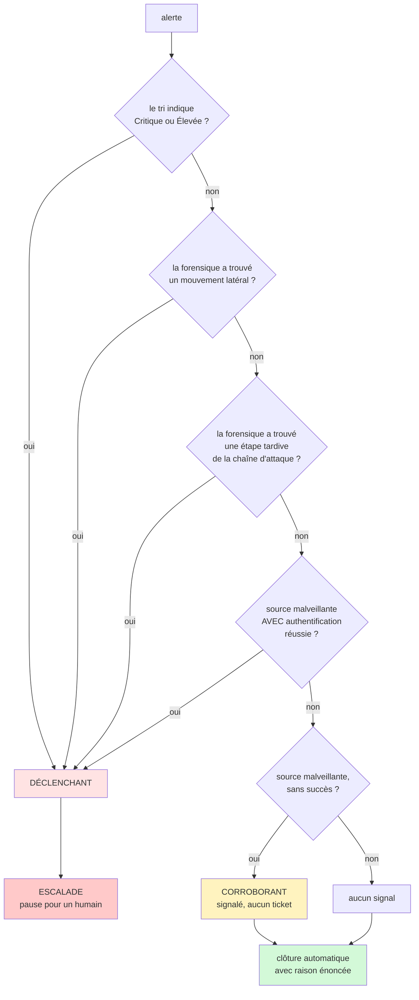

Deux propriétés garanties par cette structure :

- **Aucun signal ne dépend du modèle de langage.** Chaque branche est une
  fonction de règles, d'outils ou de requêtes en base. Cela n'a pas toujours
  été vrai — voir le constat 21.
- **Chaque alerte clôturée énonce pourquoi.** Quatre raisons de suppression
  distinctes, pour que « aucun signal » et « identifié positivement comme non
  malveillant » ne se ressemblent jamais dans une file.

Sous la politique livrée, les 738 alertes se répartissent ainsi :

| issue | alertes | |
|---|---:|---|
| réputation seule, sans preuve d'impact | 561 | `███████████████░░░░░` |
| aucun signal déclenchant | 137 | `████░░░░░░░░░░░░░░░░` |
| forensique : pas une activité malveillante | 21 | `█░░░░░░░░░░░░░░░░░░░` |
| tri : activité normale | 13 | `░░░░░░░░░░░░░░░░░░░░` |
| **escaladées vers un humain** | **6** | `░░░░░░░░░░░░░░░░░░░░` |

---

## Les 23 constats

Chaque constat s'appuie sur un script versionné que vous pouvez réexécuter.
Plusieurs enregistrent une **erreur mesurée puis corrigée**, car un projet
qui ne produit jamais de rétractation est un projet qui n'est pas testé.

### A · Ce que sont réellement les données

**1 — Les étiquettes du jeu de données sont une fonction pure du niveau de règle.**
Pour les 738 enregistrements, l'étiquette `True/False Positive` est
entièrement déterminée par `rule.level`. Les reproduire ne nécessite aucun
classificateur ; elles sont donc rapportées comme une propriété des données
et jamais utilisées comme cible d'apprentissage. → `verify.py`

**2 — 63 % des enregistrements masquent l'alerte qui compte.**
466 sur 738 sont des enveloppes de *réponse active* Wazuh dont la description
visible est `Host Blocked by firewall-drop` ; l'alerte déclenchante est
imbriquée dans `data.parameters.alert`. Lus naïvement, deux tiers du corpus
sont un journal de pare-feu. → `inspect_nested.py`

**3 — Le corpus ne contient aucune alerte grave.**
Niveaux présents : `{3: 499, 4: 4, 5: 231, 8: 4}`. Rien n'atteint le niveau
10, donc 0 Critique et 0 Élevée. Une barrière fondée uniquement sur la
gravité ne se déclenche jamais. → `analyse.py`

**4 — Le désencapsulage récupère des preuves déjà présentes.**
46 adresses source et 466 noms de machines. La couverture de classification
passe de **96,5 % à 99,6 %**. → `analyse.py`

**9 — Les noms de machines se cachaient dans le contenu des journaux.**
`agent.name` est anonymisé en `xxx`, mais 93,6 % des enregistrements portent
un `full_log` au format syslog dont le deuxième champ est la vraie machine.
L'analyser a fait passer les noms exploitables d'environ 6 % à
**691/738 = 93,6 %**. → `test_forensics.py`

**10 — C'est une capture mono-capteur, donc le mouvement latéral est absent.**
85,8 % des alertes proviennent d'une seule machine. Le détecteur rapporte
donc **0,0 % de mouvement latéral** — la bonne réponse, puisqu'il n'y a nulle
part où se déplacer. Il est validé à la place sur trois incidents
synthétiques étiquetés (une vraie intrusion, deux pièges), avec un score de
**11/11**. Une version antérieure de ce détecteur, fondée sur « même
utilisateur sur deux machines ou plus », signalait **100 %** du corpus.
→ `test_forensics.py`, `tools/scenarios.py`

### B · Ce que coûtent les outils et ce qu'ils trouvent

**5 — Réputation interne et externe ne concordent qu'à 57,4 %.**
Les 42,6 % de désaccord se décomposent en 7 scanners de recherche, 9 adresses
connues d'AbuseIPDB mais pas de nous, et 4 l'inverse. **77,1 % des alertes
portant une adresse IP venaient d'adresses qu'AbuseIPDB n'avait jamais
vues** — un système fondé uniquement sur la réputation externe est aveugle
aux trois quarts de son propre trafic. Les scanners de recherche sont
reconnus et déclassés de façon *visible*, avec `ScannerAllowlist` ajouté aux
sources. → `compare_reputation.py`

**6 — Le modèle de langage coûte environ 20× moins que l'estimation initiale.**
657 jetons, ≈ 0,00013 $ par enrichissement. Le corpus ne contient que 47
adresses uniques, d'où un **taux de succès du cache de 93,2 %**.
→ `test_llm.py`

**7 — A2A coûte 444 ms par appel ; la comparaison en temps écoulé est faussée.**
445,1 ms en JSON-RPC contre 1,4 ms en processus — **318×**, soit environ 20 %
d'une exécution à deux agents. Une version antérieure de ce constat comparait
des temps écoulés sur une seule exécution et concluait qu'A2A était *plus
rapide* ; la latence du modèle varie de plus d'une seconde, ce qui noie la
différence. **Affirmation retirée et remesurée** sur un nœud sans modèle. Le
client résout encore la Carte d'Agent à chaque appel, volontairement non
optimisé pour que le chiffre reflète une implémentation directe.
→ `measure.py`

**8 — La reproductibilité est partielle par conception.**
Règles : 500 exécutions, 1 résultat. Modèle : 16 exécutions, 3 résultats
(81 % identiques, écart maximal +12). Seule la prose vient de la couche
variable. → `measure.py`

### C · Pourquoi plus d'un agent

**15 — Le tri et la forensique sont en désaccord, et ce désaccord est l'architecture.**
Sur les cinq alertes d'une intrusion confirmée :

| alerte | tri, isolément | forensique, en contexte |
|---|---|---|
| DEMO-LM-01 | ForceBrute / Faible → clôture | MouvementLatéral → escalade |
| DEMO-LM-02 | ActivitéNormale / Info → clôture | MouvementLatéral → escalade |
| DEMO-LM-03 | ActivitéNormale / Info → clôture | MouvementLatéral → escalade |
| DEMO-LM-04 | ActivitéNormale / Info → clôture | MouvementLatéral → escalade |
| DEMO-LM-05 | ÉlévationPrivilèges / Faible → clôture | MouvementLatéral → escalade |

**Le tri clôture 5 sur 5. La forensique signale 5 sur 5.** Le tri n'a pas
tort — chaque alerte isolée *est* ordinaire. Elles ne forment une intrusion
qu'ensemble. → `tools/severity.py`, `tools/forensics.py`

**16 — Le transport A2A donne des résultats identiques.**
La même alerte à travers les quatre agents, dans les deux modes : toute
valeur dérivée des règles est identique. Seul le nombre de jetons diffère,
pour la raison qu'enregistre le constat 8. → `test_pipeline.py`

**17 — La barrière multi-agents escalade ce qu'un agent seul clôture.**
0/738 avec le tri seul ; 6/738 avec les trois agents — et **les 6 sont des
cas que le tri aurait clôturés.** → `test_gate.py`

### D · Erreurs de raisonnement, trouvées et corrigées

**11 — Une fenêtre temporelle doit être centrée, pas seulement bornée.**
`ORDER BY timestamp LIMIT 25` sur une fenêtre de ±60 minutes renvoie les 25
événements les *plus anciens* et exclut l'alerte elle-même. Le défaut était
visible dans la sortie : une limite de 25 produisait 26 événements, parce
qu'un filet de sécurité devait réinsérer l'alerte dans sa propre chronologie.
→ `tools/history.py`

**12 — Une règle de confiance consignée dans un commentaire finit par être violée.**
L'étape 9 avait retiré `full_log` du classificateur de tri parce que le texte
machine brut provoquait des classifications incohérentes ; la raison était
consignée dans une docstring. Trois étapes plus tard, l'inférence d'étape de
la forensique l'interrogeait à nouveau — et **elle avait déjà produit
l'unique (et faux) verdict `Execution` du corpus**, à partir de l'expression
« command executed » dans une ligne de journal brute. Une contrainte partagée
par deux modules appartient à une fonction partagée, pas à de la prose.

**13 — Les alertes « vulnérabilité » sont des remédiations.**
« The CVE-2025-24528 … **was solved** due to a package update » — le
classificateur reconnaissait `cve-` et s'arrêtait là. Un analyste en aurait
conclu que le parc porte 12 CVE non corrigées ; les enregistrements disent
l'inverse. Après correction, le corpus ne contient **aucune alerte de
vulnérabilité non corrigée**.

**14 — La couche langagière a produit un récit exact de faits inexacts.**
Le modèle a écrit un récit fidèle qui attribuait à son sujet trois échecs
d'authentification appartenant à un **autre attaquant** présent dans la même
fenêtre de 60 minutes. Mesuré sur le corpus :

```
événements appartenant à UN AUTRE acteur  ██████████████░░░░░░  13 314 / 18 450   72,2 %
fenêtres majoritairement étrangères       ██████████████████░░     672 / 738      91,1 %
```

Le modèle était fidèle ; ce sont les *preuves* qui étaient fausses. Une
fenêtre temporelle n'est pas un incident. Les preuves sont désormais
partitionnées en `CET ACTEUR` et `AUTRES ACTEURS` avant toute génération.
→ `test_forensics.py`

**19 — La réputation n'est pas l'impact.**
La première barrière escaladait **567 alertes sur 738 (76,8 %)** parce que
561 portaient une adresse vue plus de 50 fois dans le corpus. Les signaux
sont désormais séparés selon ce qu'ils peuvent faire seuls — un signal
**déclenchant** escalade de lui-même, un signal **corroborant** figure au
rapport mais n'ouvre aucun ticket — et la réputation est corroborante. Elle
redevient déclenchante uniquement conjuguée à une authentification réussie
enregistrée. Trois politiques ont été mesurées en volume *et* en détection,
car une barrière plus silencieuse ne vaut rien si elle est aussi aveugle.
→ `test_gate.py`

**23 — La chronologie n'était triée qu'à la seconde près.**
La suite de tests l'a trouvé quelques minutes après sa création. La fonction
`datetime()` de SQLite tronque aux secondes entières : les alertes partageant
une seconde étaient à égalité et revenaient dans un ordre arbitraire — dans
la chronologie, dans le rapport, et dans le bloc de faits fourni au modèle.
Un lecteur pouvait voir une ouverture de session au-dessus de
l'authentification qui l'avait précédée. Le tri utilise désormais
`julianday()`. Le défaut a survécu à tous les scripts de démonstration et à
trois corrections antérieures de cette même fonction, **parce qu'une
chronologie presque ordonnée ressemble exactement à une chronologie
ordonnée.** → `tests/test_history.py`

### E · Tenir le modèle à l'écart des décisions

**18 — Un point de reprise est un fichier non fiable.**
Mettre une exécution en pause écrit l'état dans un point de reprise ; la
reprise le relit. Si un attaquant peut écrire dans ce stockage, un
désérialiseur permissif devient un chemin vers l'exécution de code. Le graphe
construit son sérialiseur en mode strict et autorise explicitement les quinze
classes de contrat que l'état peut contenir. La suite s'exécute avec les
`UserWarning` promus en erreurs, ce qui fait de cette liste une affirmation
testée. → `graph.py`

**20 — L'interface peut contredire le système qui l'alimente.**
La première version affichait le chiffre principal de chaque agent comme un
`delta` Streamlit — rendu par une flèche verte ascendante, universellement
lue comme « cela s'est amélioré ». La colonne forensique affichait donc
**`+ 4 succès` en vert**, quatre authentifications réussies par un intrus, à
cinq centimètres d'une bannière rouge **ESCALADE** décrivant le même
événement. Chaque valeur était correcte ; la présentation ne l'était pas.
→ `app.py`

**21 — Le score du modèle est une loterie au nombre de tickets stable.**
Les deux évaluateurs lisent le même bloc de faits. Le même échantillon de 68
alertes, exécuté deux fois :

| | exécution 1 | exécution 2 |
|---|---|---|
| accord exact | 6/68 (8,8 %) | 12/68 (17,6 %) |
| score maximal du modèle | 72/100 | 70/100 |
| décisions modifiées | **2** | **2** |
| **quelles alertes** | `…5462`, `…3370` | `…5935`, `…3026` |

**Même nombre. Ensembles disjoints.** Trente et une alertes partageant un
même profil de preuves ont reçu les scores
`[30, 35, 38, 40, 45, 55, 60, 62, 65, 70, 72]`. Le seuil de la barrière se
situe *à l'intérieur* de cet intervalle : les alertes qui atterrissent en
haut le franchissent.

Cela avait une conséquence sur l'affirmation centrale du projet :
`threat_score >= 70` était un signal déclenchant, et `threat_score` vient du
modèle. Preuves identiques, deux scores réellement produits par le modèle —
et la barrière basculait. **Le signal a été supprimé**, sans changer le
nombre d'escalades du corpus ni la détection des incidents étiquetés.

Le résultat complémentaire est positif : vérifiée pour des affirmations que
le bloc de faits n'autorise pas, la prose du modèle a obtenu **0 violation
sur 68 hypothèses**.

> **Le langage du modèle est fiable. Ses nombres ne le sont pas.**
> Voilà l'architecture, mesurée plutôt que supposée.

→ `evaluate.py`

**22 — Un auto-test écrit par l'auteur du contrôle teste les angles morts de l'auteur.**
La première évaluation rapportait 8 affirmations non étayées sur 68. Le
chiffre était faux : « aucune indication d'activité **malveillante** » était
comptée comme une affirmation de malveillance. Le garde-fou prévu pour
exactement cela — un auto-test qui refuse de rapporter tant que le détecteur
ne se déclenche pas de façon démontrée et ne reste pas silencieux à bon
escient — **a réussi**, parce que ses cinq cas avaient été écrits par la même
personne que le contrôle et qu'aucun ne contenait de négation. Les cas
défaillants figurent désormais dans l'auto-test, repris mot pour mot de
sorties réelles du modèle. Décompte réel : **0 sur 68**. → `evaluate.py`

---

## Affirmations retirées

Conservées ici parce qu'une méthode qui ne produit jamais de rétractation
n'est pas mise à l'épreuve.

1. **« Les étiquettes du jeu de données sont une vérité terrain. »** Retirée
   après le constat 1.
2. **« A2A est plus rapide qu'un appel en processus. »** Retirée après le
   constat 7 — la comparaison utilisait des temps écoulés que la latence du
   modèle noie.
3. **« Le mouvement latéral concerne 2,5 % du corpus. »** Corrigée : ce
   chiffre venait d'un jeu de test construit localement, non des données
   réelles. Le chiffre du corpus est 0,0 %.

---

## Ce que ce projet n'est pas

Limites assumées, chacune assortie d'un chiffre lorsqu'il en existe un.

| limite | détail |
|---|---|
| **Aucune ingestion** | il lit un fichier JSON statique ; pas d'interrogation de l'API Wazuh, pas de file d'attente, pas d'« une alerte arrive à 03h12 » |
| **Les exécutions en pause ne survivent pas à un redémarrage** | le stockage des points de reprise est en mémoire ; un stockage durable est un changement d'une ligne dans `graph.py` |
| **Les points de terminaison A2A ne sont pas authentifiés** | acceptable sur `127.0.0.1`, inacceptable ailleurs |
| **Les décisions humaines ne sont pas persistées** | elles vivent dans le point de reprise et nulle part où une équipe suivante puisse les interroger |
| **Deux branches clés ne sont jamais exercées par les données réelles** | le mouvement latéral (constat 10) et source-malveillante-avec-succès (constat 19) sont validés synthétiquement, et ce README le dit plutôt que de laisser supposer une couverture |
| **`similar_alerts` est déclaré et toujours vide** | la recherche vectorielle prévue n'a pas été construite ; sur 18 profils de preuves distincts, ce serait de la mise en scène |

---

## Carte des fichiers

```
soc-triage-langgraph/
├── core/
│   ├── config.py        tous les réglages, lus depuis l'environnement
│   ├── contracts.py     le vocabulaire fermé : énumérations + modèles
│   ├── models.py        le contrat d'entrée Alert (figé, validé)
│   ├── preprocessor.py  charger, désencapsuler, normaliser, récupérer les hôtes
│   ├── llm.py           sortie structurée, réessais, tarification, et la
│   │                    promesse que seul LLMUnavailable s'échappe
│   └── state.py         SOCState, réducteurs, fabriques d'événements
├── tools/
│   ├── severity.py      règles de tri (sans IA)
│   ├── mitre.py         correspondance ATT&CK, chaque identifiant vérifié
│   ├── threat_intel.py  trois sources de réputation, le pire verdict gagne,
│   │                    cache fichier, liste des scanners de recherche
│   ├── hunter.py        collecte de preuves + synthèse d'hypothèse
│   ├── history.py       l'historique SQLite des alertes
│   ├── forensics.py     chronologie, partition par acteur, détection
│   ├── scenarios.py     incidents synthétiques étiquetés (préfixe DEMO-)
│   └── reporter.py      la barrière d'escalade et le rapport d'incident
├── a2a_agents/          quatre Cartes d'Agent + exécuteurs, un seul hôte
├── nodes/               un nœud LangGraph par agent + le client A2A
├── tests/               152 tests, une seconde, sans réseau
├── graph.py             le graphe, les routeurs, le sérialiseur strict
├── app.py               l'interface Streamlit à cinq couches
├── run_graph.py         exécuter le système sur une alerte, en direct
├── run_agents.py        démarrer l'hôte A2A
├── evaluate.py          constats 21 et 22
├── test_gate.py         constats 17 et 19
├── measure.py           constats 7 et 8
├── analyse.py           constats 3 et 4
└── data/                corpus, cache, historique SQLite (ignorés par git)
```

### Notes de sécurité

- `.env` est ignoré par git. **Ne versionnez jamais une clé.** Aucune clé
  n'est jamais affichée : les tests signalent uniquement `present` ou
  `NOT SET`.
- Une clé apparue dans un journal, une conversation ou un commit est
  compromise définitivement. Révoquez et renouvelez plutôt que de supprimer
  le message.
- Le stockage des points de reprise est traité comme une entrée non fiable
  (constat 18).
- Chaque frontière A2A valide contre un contrat, y compris les frontières
  entre nos propres agents.
- Les incidents synthétiques sont datés de 2030, préfixés `DEMO-`, portent
  `raw={"_synthetic": True}` et utilisent des adresses de documentation
  RFC 5737, pour ne jamais pouvoir être pris pour des preuves.

---

## Technologies

| composant | version |
|---|---|
| Python | 3.13 |
| LangGraph | 1.2.16 |
| a2a-sdk | 1.2.2 |
| Pydantic | 2.13 |
| langchain-openai | 1.7.2 |
| Streamlit | ≥ 1.66 |
| Starlette + uvicorn | l'hôte A2A |
| SQLite | historique des alertes (bibliothèque standard) |

Les identifiants de techniques MITRE ATT&CK ont été vérifiés en direct sur
attack.mitre.org. Notez que **TA0005 a été renommée de « Defense Evasion » en
« Stealth »**, et qu'une nouvelle tactique **TA0112 « Defense Impairment »** a
été ajoutée — c'est pourquoi `T1078 Valid Accounts` affiche sa tactique comme
`Stealth` et non sous le nom que la plupart des références utilisent encore.

---

## État d'avancement

- [x] Étapes 1–19 — contrats, quatre agents A2A, le graphe, l'interface
- [x] Étape 20 — suite de tests automatisée : 152 tests, une commande
- [x] Étape 21 — évaluation : le score du modèle n'apporte aucun signal utile
- [ ] Facultatif — recherche d'alertes similaires, mesurée ou documentée comme abandonnée
- [ ] Facultatif — mettre en cache les Cartes d'Agent, remesurer le constat 7

---

## Auteur

**Bejaoui Bechir**

Projet de démonstration doctoral : un système de tri SOC à cinq agents, dont
quatre communiquent via le protocole A2A, orchestrés par LangGraph, et où un
humain conserve la décision finale — mesuré sur un corpus réel de 738 alertes
Wazuh.

Chaque constat de ce README s'appuie sur un script présent dans ce dépôt, et
les erreurs sont documentées au même titre que les résultats. Trois
affirmations ont été retirées après mesure, et le README dit lesquelles.

Dépôt : <https://github.com/bechir08933891/soc-triage-langgraph>