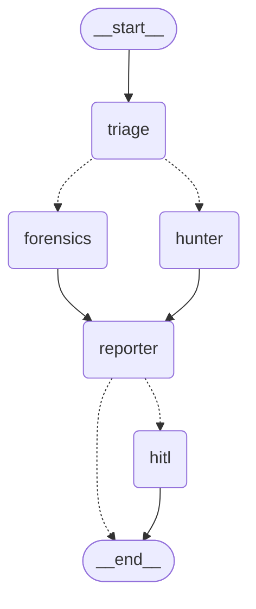

# SOC Triage Agent — LangGraph Edition

A five-agent Security Operations Centre triage system. Four software agents
speak the **A2A protocol** (Agent2Agent, Linux Foundation) over JSON-RPC;
**LangGraph** orchestrates them; the fifth agent is a human, who approves or
rejects at an interrupt-based gate.

Built and measured against a real Wazuh alert corpus of **738 records**.

**The design principle, applied everywhere:** rules and tools decide;
the language model only writes prose. Every report ends with the sentence
*"No verdict in this report was produced by a language model."* and that
sentence is true, verified by injecting model failures and confirming the
decision does not move.

---

## The orchestration graph



Solid lines are fixed edges; dotted lines are conditional. `hunter` and
`forensics` run in the **same step** — visible in the checkpoint trail as
`next -> ('hunter', 'forensics')`.

| agent | question it answers | state it owns |
|---|---|---|
| **triage** | what kind of alert is this, judged alone? | none — a pure function |
| **hunter** | is this indicator known bad, and which ATT&CK technique? | none + external intel |
| **forensics** | what else happened around it, and by whom? | **a SQLite alert history** |
| **reporter** | what does it all add up to, and does a human need to see it? | none |
| **hitl** | a person's decision | the checkpoint |

---

## Quick start

### 1. Requirements

Python 3.13, Windows/macOS/Linux. No GPU.

```cmd
python -m venv .venv
.venv\Scripts\activate
pip install -r requirements.txt
```

### 2. The dataset

The corpus is **not** in this repository. Download it:

```cmd
python download_data.py
```

That fetches `wazuh_formatted_alerts.json` (2.96 MB, 738 records) into
`data/`. The file is git-ignored.

To fetch it manually instead, it is the Wazuh alert dataset at
<https://huggingface.co/datasets/kholil-lil/wazuh-alerts> — place
`wazuh_formatted_alerts.json` in `data/`.

### 3. Keys (optional)

Create a `.env` file in the project root. **No quotes, no spaces around `=`.**

```dotenv
OPENAI_API_KEY=sk-...
ABUSEIPDB_API_KEY=...
VIRUSTOTAL_API_KEY=...
```

`.env` is git-ignored and must never be committed. Every key is optional:
without them the system runs with deterministic fallbacks and says so in the
audit trail. To disable all outbound calls, set `SOC_OFFLINE_MODE=1`.

### 4. Run it

Start the agent host in one window:

```cmd
python run_agents.py
```

In another window, run the whole system on one alert:

```cmd
python run_graph.py demo
```

`demo` is a labelled synthetic lateral-movement incident. For a real alert
from the corpus, pass its id:

```cmd
python run_graph.py 1741133026.4897
```

### 5. The transport switch

```cmd
set SOC_A2A_MODE=1    :: agents talk over A2A (needs run_agents.py)
set SOC_A2A_MODE=0    :: the same functions, called in this process
```

Both produce identical results. That is what makes the A2A claim a
measurement rather than a decoration (finding 16).

---

## Findings

Eighteen findings, each backed by a committed script you can re-run. Several
of them record mistakes that were measured and corrected, because a result
that was never wrong teaches nothing about the method that produced it.

### Finding 1 — the dataset's own labels are a pure function of the rule level

Each record carries a label (`False Positive` / `True Positive`). For all
**738/738** records the label is determined entirely by `rule.level`: level 3
is always one, everything above is always the other.

The labels therefore cannot serve as ground truth for a classifier, because
reproducing them requires only reading a single integer. They are reported
here as a property of the dataset, not used as a target.

Script: `verify.py`

### Finding 2 — 63% of records hide the alert that actually matters

**466 of 738 records (63.1%)** are Wazuh *active-response* wrappers: the
visible rule description is `Host Blocked by firewall-drop Active Response`,
and the alert that triggered it sits nested at
`data.parameters.alert`.

Read naively, nearly two thirds of the corpus is a firewall log. The
preprocessor unwraps the nested alert and attaches its description, level,
rule id, groups, host, source IP and raw log to the wrapper.

Script: `inspect_nested.py`

### Finding 3 — the corpus contains no serious alert

Wazuh levels present: `{3: 499, 4: 4, 5: 231, 8: 4}`. Nothing reaches level
10, so after mapping:

| severity | count | share |
|---|---:|---:|
| Critical | 0 | 0.0% |
| High | 0 | 0.0% |
| Medium | 4 | 0.5% |
| Low | 232 | 31.4% |
| Info | 502 | 68.0% |

A system whose escalation gate depends on rule severity alone would escalate
**nothing, ever**, on this data. That constraint drives findings 15 and 17.

Script: `analyse.py`

### Finding 4 — unwrapping recovers evidence that was already there

Unwrapping the nested alerts recovers **46 source IP addresses** and
**466 host names** that the surface record does not expose. Classification
coverage rises from **96.5% to 99.6%**, leaving 3 unclassifiable alerts.

Attack-type distribution after unwrapping and after the corrections in
finding 13:

| attack type | count | share |
|---|---:|---:|
| BruteForce | 622 | 84.3% |
| WebAttack | 73 | 9.9% |
| NormalActivity | 34 | 4.6% |
| Persistence | 4 | 0.5% |
| Unknown | 3 | 0.4% |
| PrivilegeEscalation | 2 | 0.3% |

Script: `analyse.py`

### Finding 5 — first-party and third-party reputation agree only 57.4%

Comparing a reputation built from the corpus itself (how often an address
appears) against AbuseIPDB, the two sources agree on **57.4%** of addresses.
The 42.6% disagreement decomposes into three distinct causes:

| cause | addresses | what it means |
|---|---:|---|
| research scanners | 7 | Shadowserver and similar: noisy, not hostile |
| external blind spot | 9 | AbuseIPDB knows it, our corpus does not |
| local blind spot | 4 | our corpus knows it, AbuseIPDB does not |

**77.1% of IP-bearing alerts** came from addresses AbuseIPDB had never heard
of. A system trusting only third-party reputation would be blind to three
quarters of its own traffic.

The research scanners are handled explicitly: `identify_research_scanner()`
recognises them by organisation and by network (`64.62.156.0/24` →
Shadowserver), sets the verdict to `clean`, caps confidence at 20, and
appends `ScannerAllowlist` to the sources so the downgrade is visible rather
than silent.

Scripts: `compare_reputation.py`, `test_intel.py`

### Finding 6 — the language model costs about 20× less than the design estimate

One enrichment: **657 tokens, ≈$0.00013**. The original design document
estimated roughly twenty times that. The cache helps further: the corpus
contains only **47 unique IP addresses**, giving a **93.2%** cache hit rate
on reputation lookups.

Script: `test_llm.py`

### Finding 7 — A2A costs 444 ms per call; wall-clock comparison is confounded

Measured on the LLM-free triage node, 20 runs each:

| transport | median |
|---|---:|
| A2A over JSON-RPC | **445.1 ms** |
| in-process call | **1.4 ms** |

A factor of **318×**, or roughly **20% of a two-agent run**.

An earlier version of this finding compared single-run wall-clock times and
concluded A2A was *faster*. That conclusion was wrong: language-model
latency varies by more than a second between calls, which swamps a 444 ms
transport difference. The claim was withdrawn and re-measured on a node that
makes no model call at all.

**A known, deliberate non-optimisation:** the client re-resolves the Agent
Card on every call — two round trips plus connection setup. Caching resolved
cards would reduce the figure. It is left unoptimised so the measurement
reflects the straightforward implementation of the protocol rather than a
tuned one.

Script: `measure.py`

### Finding 8 — reproducibility is partial by design

| layer | runs | distinct results |
|---|---:|---:|
| deterministic rules | 500 | **1** |
| language model | 16 | **3** (81% matched, max deviation +12) |

The rule layer is a pure function: same alert, same verdict, forever. The
generative layer is not, and no prompt makes it so. The system is therefore
built so that only *prose* comes from the variable layer, and every number a
reviewer might act on comes from the reproducible one.

Script: `measure.py`

### Finding 9 — host names were recoverable from the log payload

`agent.name` is anonymised to `xxx` in the published dataset, but 93.6% of
records carry a syslog-format `full_log` whose second field is the real host.
Parsing it raised alerts with a usable host name from roughly 6% to
**691/738 = 93.6%** and revealed four distinct hosts. The remaining 47 are
nginx access logs, whose format has no host field at all.

Script: `test_forensics.py` (Part 1)

### Finding 10 — the corpus is a single-sensor capture, so lateral movement is absent

Recovering the host names made the shape of the data visible:

| host | alerts | share |
|---|---:|---:|
| wazuh-server | 633 | 85.8% |
| unknown-host (nginx) | 47 | 6.4% |
| staging-environment | 38 | 5.1% |
| prod-server | 20 | 2.7% |

The forensics detector therefore reports **0.0% lateral movement** and
**0.7% horizontal spread (5 of 738)**. This is the correct answer: 85.8% of
alerts come from one machine, so there is nowhere to move to. The dataset
cannot exercise multi-host detection.

The detector is instead validated against three labelled synthetic incidents
(`tools/scenarios.py`), dated 2030 and prefixed `DEMO-` so they can never be
read as evidence: one true lateral movement, and two traps — a generic
`admin` account on three hosts, and a named account that reached three hosts
without a single success. **Only the first is flagged, 11/11 correct.**

An earlier version of this detector, using the rule *"same user on two or
more hosts"*, flagged **100%** of alerts. The flaw was conceptual rather than
technical: horizontal scanning had been conflated with lateral movement. The
corrected detector requires a non-generic identity with a recorded successful
authentication on more than one host inside a bounded window, and reports
scanning separately.

Scripts: `test_forensics.py` (Parts 3 and 7), `tools/forensics.py`

### Finding 11 — a time window must be centred, not merely bounded

The first timeline query used `ORDER BY timestamp LIMIT 25` over a ±60 minute
window. In a dense window this returns the oldest 25 events — the hour
*before* the alert — and excludes the alert being investigated. The fault was
visible in the output: a limit of 25 produced **26** events, because a
fallback had to re-insert the focus alert into its own timeline.

Ordering by `ABS(julianday(timestamp) - julianday(focus))` and re-sorting
chronologically places the alert at the centre and narrows the window to the
interval that actually contains activity (60 minutes down to 24 on the case
measured).

A second, related defect: an alert with no source IP and a generic account
failed the actor test against its own database row and was labelled a
stranger in its own timeline. The focus alert is the actor by definition. The
test now asserts that no window contains zero events belonging to its own
actor.

Script: `tools/history.py` (`alerts_near`), `test_forensics.py` (Part 6)

### Finding 12 — a field-trust rule held in a comment gets violated

Step 9 removed `full_log` from the triage classifier, because raw machine
text caused the same rule description to be classified two different ways.
The reason was recorded in a docstring. Three steps later the forensics stage
inference searched `full_log` again.

The impact was not zero. Restricting the search to curated fields removed the
corpus's only `Execution` classification: it had been produced by the phrase
"command executed" appearing somewhere in a raw log line, while the alert's
own rule description described an access attempt. The alert now reports
`InitialAccess`, which its description supports. **A field the system was
never meant to trust had already produced one wrong answer, and nothing had
failed to reveal it.**

Both modules now read the same trusted fields: the curated rule description,
the triggering alert's description, and Wazuh's rule groups. The
architectural lesson is that a constraint shared by two modules belongs in a
shared function, not in prose.

Scripts: `tools/severity.py`, `tools/forensics.py`

### Finding 13 — the dataset's "vulnerability" alerts are remediations

The triage rules reported 12 `Vulnerability` alerts. Reading them:

> The CVE-2025-24528 that affected libkrb5-3 **was solved** due to a package
> update

These are patches being applied. The classifier matched the token `cve-` and
stopped. An analyst reading the queue would conclude the estate carries
unpatched CVEs; the records say the opposite.

The phrase `was solved` is now matched by the non-threat family, which is
evaluated first, so a remediation notice is reported as normal activity and a
genuine CVE alert still reaches `Vulnerability`. After the correction the
corpus contains **no unpatched-vulnerability alerts at all** — only
remediation notices.

A related design decision is left deliberately in place and flagged here:
`Vulnerability` is treated as a non-threat and forced to `Info`. That is
correct for "not an active attack" and arguably wrong for queue
prioritisation. The corpus cannot settle the question, because it contains no
such alert.

A third stage value, `NotApplicable`, separates "this is not attack activity"
(**21** alerts — log rotations, logouts, patch notices) from `Undetermined`,
"I could not tell" (**7** alerts, 0.9%: three connection resets, two
uncategorised nginx messages, one active-response unblock, one empty
description). The two lead an analyst to opposite actions, so collapsing them
into one label destroys the signal. The residual 0.9% is left as
`Undetermined` deliberately: every remaining case is one or two records, and
a keyword added to fix a single row is over-fitting, not classification.

Stage distribution across the corpus:

| stage | count |
|---|---:|
| InitialAccess | 704 |
| NotApplicable | 21 |
| Undetermined | 7 |
| Persistence | 4 |
| PrivilegeEscalation | 2 |

Scripts: `test_forensics.py` (Parts 3 and 8), `tools/severity.py`

### Finding 14 — the language layer produced a correct account of incorrect facts

Given a verified fact block, the model wrote a four-sentence incident
narrative that obeyed every constraint in its prompt — and attributed to the
subject three authentication failures belonging to a different source address
and a different account, which fell inside the same 60-minute window.

The model was faithful. The evidence was wrong. The timeline query was
time-scoped ("everything within ±60 minutes") where an incident is
actor-scoped ("everything by this actor"), and in a window containing more
than one attacker those sets differ.

Measured across the whole corpus:

| | events | share |
|---|---:|---:|
| timeline events built | 18,450 | |
| belong to **this** actor | 5,136 | 27.8% |
| belong to **another** actor | 13,314 | **72.2%** |
| windows more than half foreign | 672/738 | **91.1%** |

Every one of those 13,314 events was previously offered to the model as part
of the same story.

The fix partitions the evidence before generation. Events sharing the focus
alert's source address, or its account when that account is a real identity
rather than a shared one, are presented under `THIS ACTOR`; the remainder
appear under `OTHER ACTORS` with an explicit instruction not to attribute
them. The deterministic analysis also states how many events in the window
belong to someone else, so a reviewer reading the machine-checked sentence is
told before reading the prose. After the change, the model dropped the
foreign events entirely.

Two architectural points follow. First, the generation step was not the weak
link: a prompt rule cannot repair an attribution boundary the evidence never
contained. Second, the fault was visible in the model's *input*, which is why
every fact block in this project is printable and is printed in its test —
the defect was found by reading what the model was given, not by doubting
what it said.

Scripts: `test_forensics_llm.py` (Part 1), `test_forensics.py` (Part 6)

### Finding 15 — triage and forensics disagree on the same alerts, and the disagreement is the architecture

The two agents were given the five alerts of a confirmed lateral-movement
incident (synthetic and labelled):

| alert | triage, one alert alone | forensics, in context | triage escalates? |
|---|---|---|---|
| DEMO-LM-01 | BruteForce / Low | LateralMovement | no |
| DEMO-LM-02 | NormalActivity / Info | LateralMovement | no |
| DEMO-LM-03 | NormalActivity / Info | LateralMovement | no |
| DEMO-LM-04 | NormalActivity / Info | LateralMovement | no |
| DEMO-LM-05 | PrivilegeEscalation / Low | LateralMovement | no |

**Triage would auto-close 5 of 5. Forensics flags 5 of 5.**

Triage is not wrong. `PAM: Login session opened.` is normal activity, and a
successful authentication at Wazuh level 3 is the most ordinary event in a
Linux estate. Each alert, judged alone, is noise. They are an intrusion only
together.

Two consequences follow:

1. Context is not an enhancement layered on triage. It answers a different
   question and returns a different answer, which is the empirical case for a
   multi-agent design rather than one larger classifier.
2. `escalate_to_tier2` from the triage agent is an **input** to routing, never
   the routing decision. A graph that branched on it would auto-close this
   incident five times.

Scripts: `tools/severity.py`, `tools/forensics.py`, `tools/scenarios.py`

### Finding 16 — the A2A transport is result-identical, and the audit trail shows where it is not

The same alert was run through all four agents twice, once with
`SOC_A2A_MODE=1` (agents discovered through their Agent Cards and called over
JSON-RPC) and once with `SOC_A2A_MODE=0` (the same functions in-process):

| | over A2A | in process |
|---|---|---|
| triage | NormalActivity / Info (score 10, conf 90%) | identical |
| hunter | score 10/100, 1 IOC, worst clean | identical |
| forensics | LateralMovement, 8 events (5 this actor), lateral=True | identical |
| report | ESCALATE, ~4.5 KB | identical decision |
| tokens | 932 | 838 |
| errors | none | none |

Every rule-derived value is identical. Only the token count differs, for the
reason already recorded in finding 8: the model's output length varies
between calls. The distinction is visible in the audit trail rather than
inferred — each run logs which transport it used, which layer produced each
claim, and the exact token counts the remote agent reported back through A2A
artifact metadata.

Scripts: `test_pipeline.py`, `test_graph.py`, `nodes/a2a_client.py`

### Finding 17 — the multi-agent gate escalates what a single agent closes

The escalation decision is the **union** of every agent's signals, computed
deterministically before any language model is contacted. Measured across all
738 alerts with triage and forensics:

| | alerts | share |
|---|---:|---:|
| triage alone escalates | 0 | 0.0% |
| triage + forensics escalates | 6 | 0.8% |
| of which triage would have **closed** | 6 | 0.8% |
| explicitly suppressed as non-attack | 34 | 4.6% |

Every alert the system escalates is one a single-agent design would have
auto-closed, because no alert in this corpus reaches High severity
(finding 3) and the rule gate therefore never fires at all.

That measurement excludes the hunter, whose reputation lookups are measured
separately by `test_gate.py` (which runs all three agents from the cache in
about a second). On a live run of a real corpus alert the hunter supplied the
override on its own: triage said `BruteForce / Low → auto-close` while
AbuseIPDB returned `malicious, 90%`, and the gate escalated.

The decision was verified **model-independent**: identical across a working
model, an injected `LLMUnavailable`, and an injected `KeyError`. The report
also states the disagreement rather than reconciling it, and both independent
runs of the summary model wrote the sentence *"The agents disagree"*,
prompted by nothing but the rule in its system prompt.

Scripts: `test_reporter.py`, `test_gate.py`, `tools/reporter.py`

### Finding 18 — a checkpoint is an untrusted file

Pausing a run writes the state to a checkpoint; resuming reads it back.
LangGraph 1.2.16 warned on every resume that deserialising our domain types
is permitted only for now and *"will be blocked in a future version"*. The
underlying reason is a security one the warning only hints at: if an attacker
can write to the checkpoint store, a permissive deserialiser is a path to
code execution.

The graph therefore builds its serialiser in strict mode
(`allowed_msgpack_modules=None`) and allow-lists exactly the **fifteen**
contract classes the state can contain, by class rather than by module name,
so a typo is an import error rather than a silent failure to restore a paused
run. The whole graph test suite is run with `-W error::UserWarning`, which
turns any unlisted type into a test failure. It passes in both transports.

The same suite covers the two graph behaviours that fail *silently* when they
are wrong:

- a skipped branch must not block the join — `reporter` still runs when
  `hunter` is skipped for an alert with no source address
- an unrecognised human answer at the gate must resolve to `escalated`, never
  `approved`

Scripts: `graph.py` (`make_serializer`), `test_graph.py`

---

## Withdrawn claims

Two claims were made, tested, and retracted. They are kept here because a
method that never produces a retraction is a method that is not being tested.

1. **"The dataset labels are ground truth."** Withdrawn after finding 1:
   the labels are a pure function of `rule.level` and reproducing them
   requires no classifier.
2. **"A2A is faster than in-process calling."** Withdrawn after finding 7:
   the comparison used single-run wall-clock times, which language-model
   latency variance swamps. Re-measured on a model-free node, A2A is 318×
   slower per call.

A third set of numbers was corrected rather than withdrawn: an early
lateral-movement rate of "2.5%" was computed on a locally-built test fixture
rather than on the real corpus. The corpus figure is 0.0% (finding 10).

---

## Architecture

```
soc-triage-langgraph/
├── core/
│   ├── config.py        every setting, read from the environment
│   ├── contracts.py     the closed vocabulary: enums + output models
│   ├── models.py        the Alert input contract (frozen, validated)
│   ├── preprocessor.py  load, unwrap, normalise, recover host names
│   ├── llm.py           the model layer: structured output, retries,
│   │                    pricing, and "only LLMUnavailable escapes"
│   └── state.py         SOCState, reducers, event and usage factories
├── tools/
│   ├── severity.py      triage rules (no AI)
│   ├── mitre.py         ATT&CK mapping, every ID verified live
│   ├── threat_intel.py  three reputation sources, worst verdict wins,
│   │                    file cache, research-scanner allowlist
│   ├── hunter.py        evidence gathering + hypothesis synthesis
│   ├── history.py       the SQLite alert history
│   ├── forensics.py     timeline, actor partition, movement detection,
│   │                    narrative synthesis
│   ├── scenarios.py     labelled synthetic incidents (prefixed DEMO-)
│   └── reporter.py      the escalation gate and the incident report
├── a2a_agents/
│   ├── triage_agent.py      agent 1 — Agent Card + executor
│   ├── hunter_agent.py      agent 2
│   ├── forensics_agent.py   agent 3 (the only stateful one)
│   ├── reporter_agent.py    agent 4
│   └── server.py            all four on one port, different paths
├── nodes/
│   ├── a2a_client.py     generic A2A caller; knows nothing about security
│   ├── triage_node.py    ┐
│   ├── hunter_node.py    │ each: choose transport, call, record events
│   ├── forensics_node.py │
│   ├── reporter_node.py  ┘
│   └── hitl_node.py      the human gate, via interrupt()
├── graph.py              the graph, routers, and strict checkpoint serde
├── run_graph.py          run the system on one alert, live
├── run_agents.py         start the A2A host
├── download_data.py      fetch the corpus
├── analyse.py            findings 3, 4
├── verify.py             finding 1
├── inspect_nested.py     finding 2
├── inspect_classes.py    label and class distribution
├── compare_reputation.py finding 5
├── measure.py            findings 7, 8
├── test_intel.py         the reputation layer and its cache
├── test_llm.py           finding 6
├── test_node.py          one node, both transports
├── test_two_nodes.py     triage + hunter
├── test_pipeline.py      all four agents, both transports (finding 16)
├── test_forensics.py     findings 9, 10, 11, 13, 14
├── test_forensics_llm.py the narrative layer, five failure paths
├── test_reporter.py      finding 17, model-independence
├── test_graph.py         finding 18, routing, interrupt/resume
├── test_gate.py          the complete three-agent gate
├── data/                 corpus, cache, SQLite history (all git-ignored)
├── requirements.txt
├── .env                  keys — GIT-IGNORED, never commit
└── .gitignore
```

### Why A2A at all

A2A is a genuine cost: 444 ms per call, and context that was free inside one
process must now be passed explicitly (the hunter cannot know how often an
address appears in the corpus, so the caller sends `local_hits`). It buys
three things:

1. **Published capability.** Each agent serves an Agent Card at
   `/.well-known/agent-card.json` describing what it does and what it
   returns. A caller who knows only the address can discover the rest.
2. **A real boundary.** Every agent validates its input against a Pydantic
   contract at the door, because anything arriving over a network is
   untrusted — including another one of our own agents.
3. **Replaceability.** Moving an agent to another machine changes an address
   in a card, not a line of orchestration code.

Four agents in one process use about 150 MB; four separate servers would use
about 600 MB. Each still has its own card and its own endpoint, so it is
genuinely A2A — just efficiently hosted.

### What the language model is and is not allowed to do

| | produced by |
|---|---|
| attack type, severity, escalation signals | deterministic rules |
| indicator verdicts, MITRE techniques | tools and external sources |
| timeline, actor split, attack stage | database queries and rules |
| the prose | the language model |

The constraint is structural, not instructional. `ForensicsNarrative` has two
fields — `narrative` and `containment_priority` — and no field for a stage or
a verdict. `ReportSummary` has `summary` and `confidence` and no field for
`escalate`. A prompt saying "do not change the decision" can be ignored; a
schema with nowhere to put one cannot.

Every model call has five paths, all of which return a usable result: skipped
deliberately, no key, success, documented failure, and unexpected crash. The
last one exists because the "only `LLMUnavailable` escapes" guarantee was
broken once, in Step 13, and killed a running script.

---

## Running the tests

With the agent host running in another window:

```cmd
python test_graph.py
python test_pipeline.py
python test_reporter.py
python test_forensics.py
python test_forensics_llm.py
python test_two_nodes.py
```

To prove the checkpoint allowlist is complete, promote warnings to errors:

```cmd
python -W error::UserWarning test_graph.py
```

The corpus-wide measurements need no server:

```cmd
python analyse.py
python verify.py
python measure.py
```

The complete escalation gate refuses to run without offline mode, so it
cannot accidentally fire 738 model calls:

```cmd
set SOC_OFFLINE_MODE=1
python test_gate.py
set SOC_OFFLINE_MODE=0
```

Offline mode still reads the reputation cache, so the verdicts are the real
ones; it blocks only new network calls and the model, neither of which can
affect the decision.

---

## Security notes

- `.env` is git-ignored. **Never commit a key.** No key is ever printed:
  tests report only `present` or `NOT SET`.
- An API key that has appeared in a log, a chat, a screenshot or a commit is
  compromised permanently. Revoke and rotate it rather than deleting the
  message.
- Git-ignored: `.env`, `data/wazuh_formatted_alerts.json`, `data/*.db`,
  `data/chroma/`, `playground.py`, `.venv/`.
- The checkpoint store is treated as untrusted input (finding 18).
- Every A2A boundary validates its input against a contract, including
  boundaries between our own agents.
- The synthetic incidents in `tools/scenarios.py` are dated 2030, prefixed
  `DEMO-`, carry `raw={"_synthetic": True}`, and use RFC 5737 documentation
  addresses, so they can never be mistaken for evidence or for a real host.

---

## Status

- [x] Step 1 — Environment, virtual environment, dependencies
- [x] Step 2 — Project skeleton and packages
- [x] Step 3 — `core/config.py`, settings from the environment
- [x] Step 4 — `core/models.py`, the validated `Alert` contract
- [x] Step 5 — `core/contracts.py`, the closed vocabulary
- [x] Step 6 — `core/state.py`, `SOCState` and its reducers
- [x] Step 7 — A2A: the triage agent, the server, the client (agent 1 of 5)
- [x] Step 8 — First GitHub push, dataset download instructions
- [x] Step 9 — The real corpus: findings 1–4, preprocessor corrections
- [x] Step 10 — `tools/severity.py` and `tools/mitre.py`
- [x] Step 11 — The triage node and the transport switch
- [x] Step 12 — `tools/threat_intel.py`: three sources, cache, finding 5
- [x] Step 13 — `core/llm.py`: structured output, retries, finding 6
- [x] Step 14 — The hunter agent and node (agent 2 of 5)
- [x] Step 14B — Transport overhead and reproducibility: findings 7, 8
- [x] Step 15 — Forensics tools: host recovery, SQLite history, movement
- [x] Step 16 — Forensics narrative and A2A agent (agent 3 of 5)
- [x] Step 17 — Reporter agent: the escalation gate (agent 4 of 5)
- [x] Step 18 — The graph: parallel fan-out, conditional edges, HITL
- [ ] Step 19 — Streamlit interface (five visual layers)
- [ ] Step 20 — Automated test suite
- [ ] Step 21 — Evaluation: does the model's score add signal over the rules?
- [ ] Step 22 (optional) — Cache resolved Agent Cards, re-measure finding 7
- [ ] Step 23 (optional) — Expose the whole system as one A2A agent

---

## Stack

| component | version |
|---|---|
| Python | 3.13 |
| LangGraph | 1.2.16 |
| a2a-sdk | 1.2.2 |
| Pydantic | 2.13 |
| langchain-openai | 1.7.2 |
| Starlette + uvicorn | A2A host |
| SQLite | alert history (standard library) |

MITRE ATT&CK technique IDs were verified live against attack.mitre.org.
Note that **TA0005 has been renamed from "Defense Evasion" to "Stealth"**,
and a new tactic **TA0112 "Defense Impairment"** has been added — which is
why `T1078 Valid Accounts` reports its tactic as `Stealth` in the output
above rather than the name most references still use.