# 🛡️ SOC Triage Agent — LangGraph Edition

**Bejaoui Bechir** · doctoral demonstration project

**[🇫🇷 Lire en français](README.fr.md)**

A five-agent Security Operations Centre triage system. Four software agents
speak the **A2A protocol** (Agent2Agent, Linux Foundation) over JSON-RPC,
**LangGraph** orchestrates them, and the fifth agent is a human who approves
or rejects at a gate that pauses the graph mid-run.

Built and measured against a real Wazuh alert corpus of **738 records**.

> **The rule the whole system is built around:**
> rules and tools **decide**; the language model only **writes prose**.
> Every report ends with *"No verdict in this report was produced by a
> language model."* — and that sentence is tested, not asserted.

---

## ▶️ Run the demo

**Window 1 — the agent host.** Leave it open:

```cmd
cd C:\Users\RONIN\Desktop\soc-triage-langgraph
.venv\Scripts\activate
python run_agents.py
```

**Window 2 — the run:**

```cmd
cd C:\Users\RONIN\Desktop\soc-triage-langgraph
.venv\Scripts\activate
set SOC_A2A_MODE=1
python run_graph.py demo
```

**Window 3 — the interface:**

```cmd
cd C:\Users\RONIN\Desktop\soc-triage-langgraph
.venv\Scripts\activate
set SOC_A2A_MODE=1
streamlit run app.py
```

Full setup, keys and troubleshooting: [Quick start](#quick-start).

---

## Table of contents

| | |
|---|---|
| [Visual guide](#visual-guide) | the whole system in seven diagrams |
| [What problem this solves](#what-problem-this-solves) | why SOC triage is hard |
| [How it works](#how-it-works) | the five agents and the graph |
| [One alert, end to end](#one-alert-end-to-end) | what actually happens |
| [The headline results](#the-headline-results) | the numbers that matter |
| [Quick start](#quick-start) | install and run it |
| [How a decision is made](#how-a-decision-is-made) | the escalation gate |
| [The 23 findings](#the-23-findings) | everything measured |
| [Withdrawn claims](#withdrawn-claims) | what was retracted |
| [What this is not](#what-this-is-not) | honest limits |
| [File map](#file-map) | where everything lives |

---

## Visual guide

Seven pictures that explain the whole system before you read a word of prose.
All of them draw themselves on GitHub — there are no image files to download.

### 1 · The rule the system is built on

Two zones. The left one is allowed to **decide**; the right one is only
allowed to **describe**. There is no arrow coming back from right to left,
and that absence is the entire design.

```mermaid
flowchart LR
    subgraph DECIDE["🔒 ALLOWED TO DECIDE — 500 runs, 1 result"]
        direction TB
        R1["severity.py<br/>triage rules"]
        R2["mitre.py<br/>ATT&CK mapping"]
        R3["threat_intel.py<br/>reputation"]
        R4["history.py<br/>SQLite queries"]
        R5["forensics.py<br/>movement detection"]
        R6["reporter.py<br/>the escalation gate"]
    end
    subgraph DESCRIBE["✍️ ALLOWED ONLY TO DESCRIBE — 16 runs, 3 results"]
        direction TB
        L1["hunter hypothesis<br/>prose"]
        L2["forensics narrative<br/>prose"]
        L3["containment priority<br/>a label, never a verdict"]
    end
    DECIDE -->|"facts that are already decided"| DESCRIBE
    DESCRIBE -->|"sentences, nothing else"| OUT["📄 incident report"]
    DECIDE ==>|"every verdict, every flag, every number"| OUT
    style DECIDE fill:#e7f5ff,stroke:#1971c2
    style DESCRIBE fill:#fff9db,stroke:#f08c00
```

The model reads facts and writes sentences. It never hands a number back to
the deciding layer. **Finding 21** is the story of the one time this was not
true, and what measuring it cost.

### 2 · How a raw record becomes an alert

Two thirds of the corpus arrives disguised as a firewall log. This pipeline
is why the system sees 99.6% of the data instead of 36.9%.

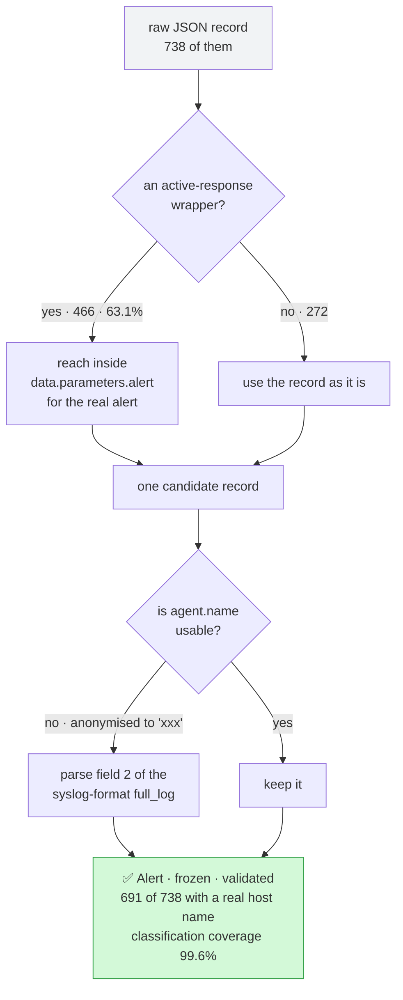

Nothing here is invented. Every field recovered was already in the file —
**findings 2, 4 and 9** are all about evidence that was present and unread.

### 3 · The life of one run, including the pause

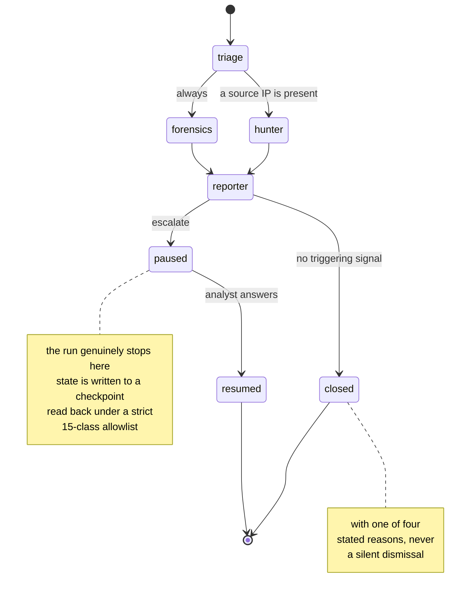

`hunter` and `forensics` leave `triage` in the **same step**, not one after
the other. `reporter` waits for both, and still runs when `hunter` was
skipped — a join that fails silently when wrong, so it has its own test.

### 4 · 738 alerts in, 6 out

Every alert ends in exactly one of five places, and the five add to 738.

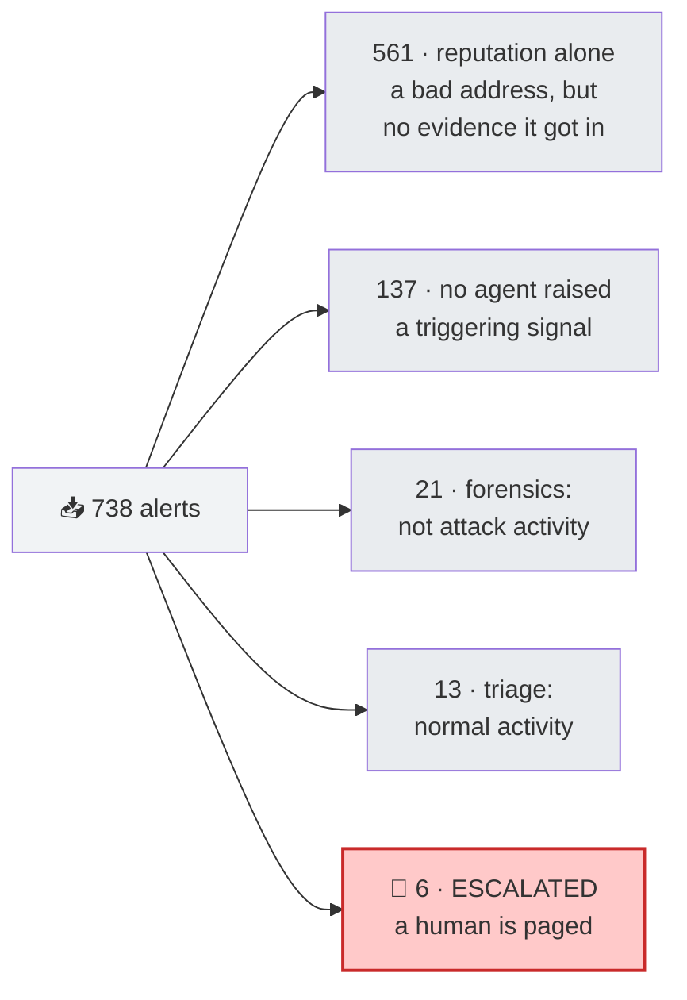

The first version of this gate put **567** in the red box. All 561 of those
had a known-bad address and nothing else. A bad address knocking is the
internet; a bad address that **got in** is an incident — **finding 19**.

### 5 · Why a time window is not an incident

The single most expensive mistake in the project. A 60-minute window around
one alert contains, on average, **72.2% events belonging to somebody else**.

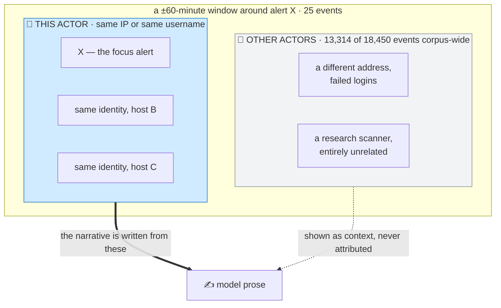

Before this split, the model wrote a perfectly faithful narrative that
blamed its subject for three failed logins belonging to a **different
attacker** in the same hour. The prose was not the problem; the evidence
was — **finding 14**.

### 6 · The layers, and what depends on what

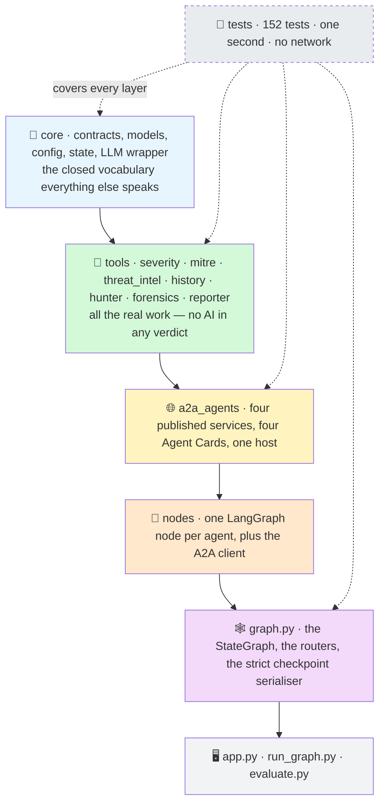

Each layer only knows the one below it. `tools/` has never heard of A2A,
which is why `SOC_A2A_MODE=0` and `SOC_A2A_MODE=1` produce identical
results — **finding 16**.

### 7 · What actually happens in one A2A call

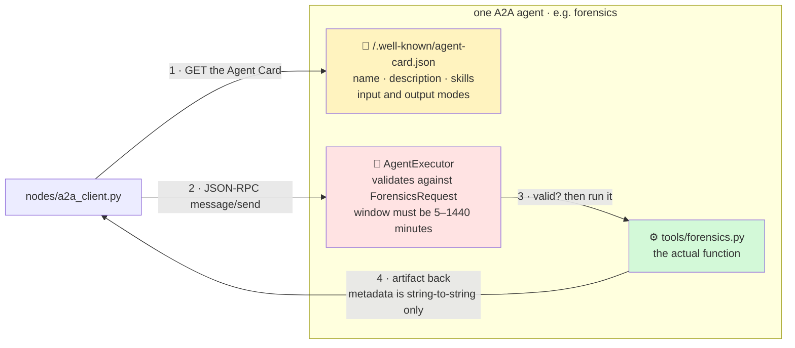

Step 2 is the one that costs **444 ms** — about 20% of a two-agent run
(**finding 7**). Step 3 is why that cost is paid: a boundary that rejects a
malformed request is a boundary, and the agent could move to another machine
by changing an address. Step 1 is deliberately not cached, so the measured
figure reflects a straightforward implementation rather than a tuned one.

---

## What problem this solves

A **Security Operations Centre** is the team that watches an organisation's
logs for signs of attack. Their monitoring software — here, **Wazuh** —
raises an *alert* whenever something matches a rule: a failed login, a
suspicious web request, a changed system file.

The difficulty is volume. A medium-sized estate produces thousands of alerts
a day, and the overwhelming majority are noise: the internet knocking on
doors that stay shut. A human analyst must look at each one and decide
*close it* or *investigate it*. That decision is called **triage**, and
making it badly in either direction is expensive:

- close too much → a real intrusion is missed
- escalate too much → analysts stop reading the queue, and a real intrusion
  is missed anyway

This project asks whether a **group of specialised agents** does that job
better than one classifier, and whether a **language model** has any
business making the call. Both questions are answered with measurements
rather than argument.

### What the corpus actually contains

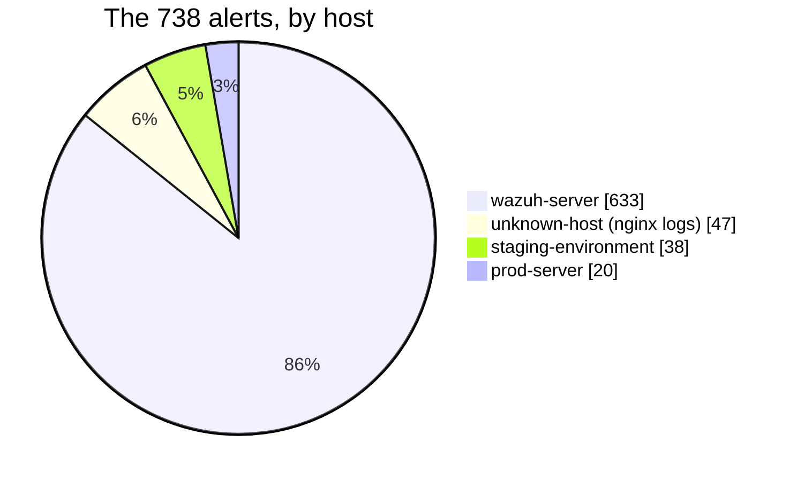

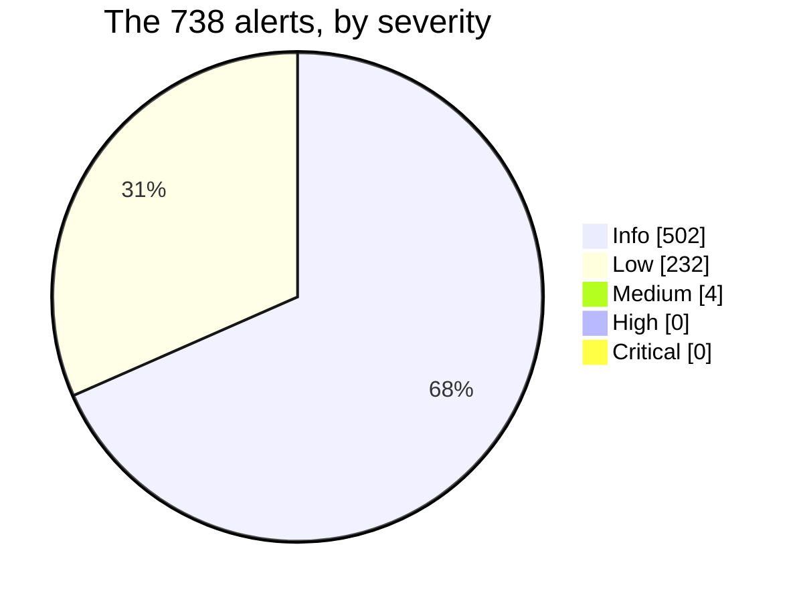

Two facts jump out, and both shaped every design decision that follows:

1. **Nothing is serious.** Not one alert reaches High severity. A system
   that escalates on rule severity alone would escalate *nothing, ever*.
2. **It is one machine.** 85.8% of alerts come from a single sensor under
   constant scanning from the internet.

---

## How it works

### The five agents

| | agent | the question it answers | what it owns |
|---|---|---|---|
| 1 | **triage** | *What kind of alert is this, judged alone?* | nothing — a pure function |
| 2 | **hunter** | *Is this address known bad, and which ATT&CK technique is it?* | nothing + external intelligence |
| 3 | **forensics** | *What else happened around it, and by whom?* | **a SQLite alert history** |
| 4 | **reporter** | *What does it all add up to, and does a human need to see it?* | nothing |
| 5 | **the human** | *Act, or close it?* | the final decision |

Each of the four software agents is a genuine A2A service: it publishes an
**Agent Card** at `/.well-known/agent-card.json` describing what it does,
validates everything arriving at its door against a contract, and could be
moved to another machine by changing an address.

### The orchestration graph

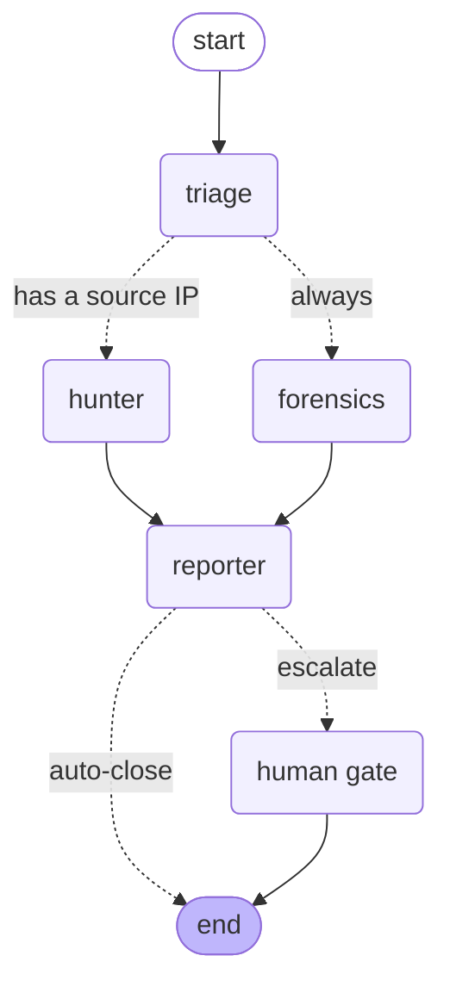

Solid lines are fixed edges; dotted lines are **conditional**. Three things
in that picture are worth stopping on:

- **`hunter` and `forensics` run in the same step.** They answer different
  questions and neither needs the other's answer. The checkpoint trail
  records this literally as `next -> ('hunter', 'forensics')`.
- **`hunter` is skipped when there is no source address.** Nothing to look
  up. The reporter still runs — a skipped branch must not block the join,
  and that is one of the behaviours that fails *silently* when wrong, so it
  is tested explicitly.
- **The gate only appears when the alert actually escalated.** A gate that
  always appears is not a gate; it is a confirmation dialog.

---

## One alert, end to end

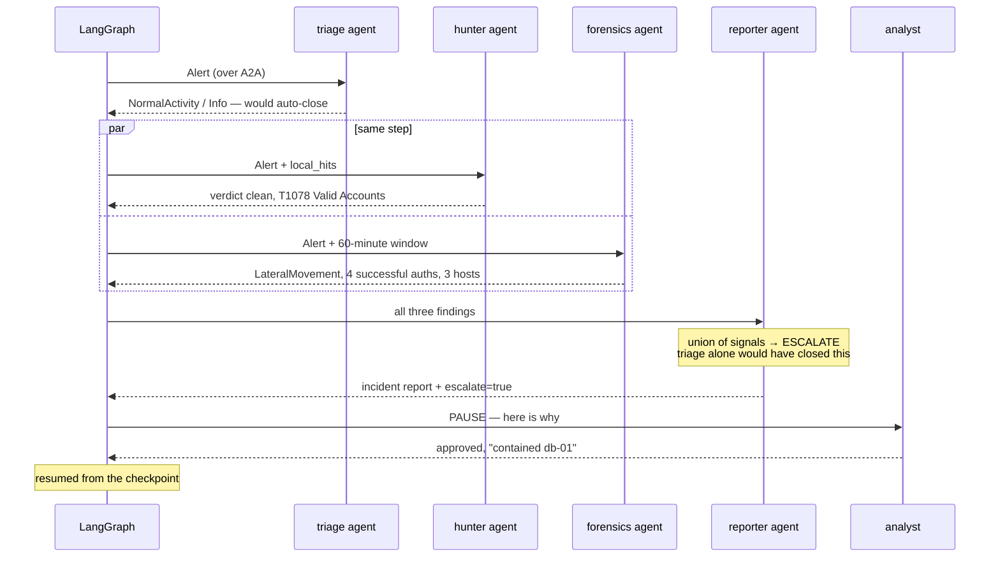

That example is real. Triage calls it **normal activity** — and triage is
not wrong: `PAM: Login session opened.` at Wazuh level 3 is the most
ordinary event in a Linux estate. Forensics, looking at the same alert's
*neighbourhood*, finds the same identity authenticating successfully on
three machines inside twelve minutes.

**Neither agent is wrong. They answer different questions.** That
disagreement is the entire argument for a multi-agent design, and the report
states it rather than averaging it away.

### The interface


Five layers, each showing something the project measured: the live audit
trail, what each agent concluded side by side, the evidence behind every
claim, the human gate, and the incident report.

---

## The headline results

### The escalation gate

How many of 738 alerts get sent to a human?

```
the first gate (reputation escalates)  ███████████████░░░░░  567   76.8%
triage alone                           ░░░░░░░░░░░░░░░░░░░░    0    0.0%
all three agents (shipped)             ░░░░░░░░░░░░░░░░░░░░    6    0.8%
```

The first gate was a **failure**: 76.8% of alerts sent to a human is the
alert fatigue the system exists to remove, relocated one step to the right.
The cause was conceptual — it read *reputation* as *impact*. A known-bad
address knocking on a door is the internet; a known-bad address that **got
in** is an incident.

The corrected gate escalates 6, and **all 6 are alerts triage alone would
have closed.** It still catches 5/5 of a confirmed intrusion and 0/6 of the
two spraying scenarios designed to fool it.

### Where the time and money go

```
A2A call (per agent)       ████████████████████  445.1 ms
in-process call            ░░░░░░░░░░░░░░░░░░░░    1.4 ms   (318× faster)

one language-model call    ~657 tokens   ≈ $0.00013
the whole evaluation       68 calls      ≈ $0.01
```

A2A is a real cost, paid deliberately for published capability, a validated
boundary, and replaceability.

### How reproducible is it?

```
deterministic rules   500 runs  →  1 distinct result        ██████████ 100%
the language model     16 runs  →  3 distinct results       ████░░░░░░  81% matched
```

That split is the whole architecture. The reproducible layer produces every
number anyone acts on; the variable layer produces sentences.

---

## Quick start

### The shortest path that works

No keys, no server, one window. This is the version to use thirty seconds
before a demonstration.

```cmd
git clone https://github.com/bechir08933891/soc-triage-langgraph.git
cd soc-triage-langgraph
pip install -r requirements.txt
set SOC_A2A_MODE=0
python run_graph.py demo
```

`demo` is a labelled synthetic lateral-movement incident built into the
project, so this works **before** the dataset is downloaded and **without**
any API key. You should see the five agents report in turn, the gate decide
**ESCALATE**, and the run pause at the human gate.

> **`set SOC_A2A_MODE=0` is not optional here.** `core/config.py` defaults
> `A2A_MODE` to **true**, so without that line the run looks for an A2A
> server that is not running and fails on a connection error. Leave it out
> only when `python run_agents.py` is already open in another window.

Everything below is the full setup.

### 1 · Get the code and a clean environment

```cmd
git clone https://github.com/bechir08933891/soc-triage-langgraph.git
cd soc-triage-langgraph
python -m venv .venv
```

Then activate it:

| system | command |
|---|---|
| **Windows, cmd** | `.venv\Scripts\activate` |
| Windows, PowerShell | `.venv\Scripts\Activate.ps1` |
| macOS / Linux | `source .venv/bin/activate` |

```cmd
pip install -r requirements.txt
```

**What you should see:** your prompt now starts with `(.venv)`, and
`python --version` reports 3.13.x. No GPU is used; the whole project runs
comfortably in 8 GB of RAM.

### 2 · Get the dataset

The 738-record corpus is **not** in this repository — it is downloaded.

```cmd
python download_data.py
```

**What you should see:** `wazuh_formatted_alerts.json`, 2.96 MB, appearing in
`data/`. That folder is git-ignored, so it never leaves your machine.

To fetch it by hand instead, it is the Wazuh alert dataset at
<https://huggingface.co/datasets/kholil-lil/wazuh-alerts> — put the file in
`data/` under that exact name.

> Skip this step and the demo still runs, but anything touching real alerts
> (`run_graph.py <alert-id>`, `test_gate.py`, `evaluate.py`) will tell you the
> corpus is missing rather than failing obscurely.

### 3 · The alert history database

The forensics agent needs a searchable history to look around an alert. You
do **not** build it by hand — it builds itself from the corpus the first time
something asks for it, into `data/soc_history.db` (also git-ignored).

**What you should see** in the audit trail, one of three honest outcomes:

| message | meaning |
|---|---|
| `history ready` | the database already exists and has rows |
| `history built: 738 alerts` | it was just created from the corpus |
| `history EMPTY: <reason>` | it could not be built, and it says why |

The third case is a stated failure, not a silent one. The usual reason is
step 2 having been skipped.

### 4 · Keys — all three are optional

Create a file called `.env` in the project root. **No quotes, no spaces
around the `=`.**

```dotenv
OPENAI_API_KEY=sk-...
ABUSEIPDB_API_KEY=...
VIRUSTOTAL_API_KEY=...
```

| key | what you lose without it |
|---|---|
| `OPENAI_API_KEY` | the narrative prose. Every verdict, score and escalation decision is unaffected — that is the whole design (see finding 21). |
| `ABUSEIPDB_API_KEY` | third-party reputation. First-party reputation from the corpus still works. |
| `VIRUSTOTAL_API_KEY` | a second opinion on reputation. |

Without any key the system runs on deterministic fallbacks and **says so in
the audit trail** rather than pretending. To block every outbound call
outright:

```cmd
set SOC_OFFLINE_MODE=1
```

`.env` is git-ignored and must never be committed. No key is ever printed
anywhere — the tests report only `present` or `NOT SET`.

### 5 · Run it

Choose a transport first. This is the one setting worth understanding:

```cmd
set SOC_A2A_MODE=0    :: the four agents are called as functions, in one process
set SOC_A2A_MODE=1    :: the four agents talk over A2A, and need a server running
```

**The default is `1`.** `core/config.py` reads
`A2A_MODE = _flag("SOC_A2A_MODE", default=True)`, so a fresh `cmd` window
that never sets the variable runs in A2A mode and expects a server. Set it
explicitly rather than relying on the default, and remember that `set` only
applies to the window you typed it in.

**With `SOC_A2A_MODE=0`** — one window, nothing else needed:

```cmd
python run_graph.py demo
```

**With `SOC_A2A_MODE=1`** — two windows. First window, leave it running:

```cmd
python run_agents.py
```

**What you should see:** four agents registered on `127.0.0.1:9001`, each at
its own path, and the process staying open. Second window:

```cmd
set SOC_A2A_MODE=1
python run_graph.py demo
```

Either way, to run a real alert from the corpus instead of the demo, pass its
id:

```cmd
python run_graph.py 1741133026.4897
```

Both transports produce identical verdicts — that is finding 16, and it is
what makes the A2A claim a measurement rather than a decoration.

### 6 · The interface

```cmd
pip install "streamlit>=1.66"
streamlit run app.py
```

It opens at <http://localhost:8501>. The sidebar's **Check the agents**
button confirms the A2A host is reachable — worth pressing before a
demonstration rather than during one.

### 7 · The tests

```cmd
pytest
```

**What you should see:** `152 passed` in roughly one second, with no network,
no model calls and nothing spent.

| command | what it runs |
|---|---|
| `pytest` | 142 tests; the 10 A2A ones skip when no server is running |
| `pytest -m a2a` | the A2A surface — needs `run_agents.py` in another window |
| `pytest -k reputation` | just the escalation gate of finding 19 |
| `pytest -v` | one line per test, if you want to read what is covered |

`tests/conftest.py` sets `SOC_OFFLINE_MODE=1` before any import, so the suite
cannot reach the network even by accident.

### If something goes wrong

| what you see | what it means | fix |
|---|---|---|
| `ModuleNotFoundError: No module named 'core'` | you are not in the project root, or the venv is not active | `cd` into the folder, re-activate, then run again |
| `corpus not found` / `history EMPTY` | the dataset was never downloaded | `python download_data.py` |
| the run hangs, then a connection error | `SOC_A2A_MODE=1` but no server | start `python run_agents.py` in another window, or set `SOC_A2A_MODE=0` |
| `address already in use` on 9001 | a previous `run_agents.py` is still alive | close that window, or find the process on port 9001 and stop it |
| `LLM unavailable` in the audit trail | no `OPENAI_API_KEY`, or it is wrong | this is not a failure — verdicts are unaffected, only the prose is missing |
| no key is read from `.env` | quotes or spaces around the `=` | write `OPENAI_API_KEY=sk-...` with nothing else on the line |

---

## How a decision is made

The escalation decision is the **union** of every agent's signals, computed
before any language model is contacted:

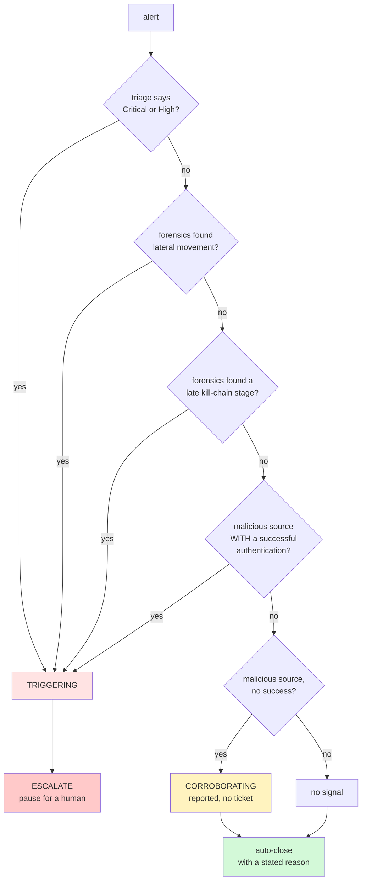

Two properties this shape guarantees:

- **No signal depends on the language model.** Every branch is a function of
  rules, tools or database queries. This was not always true — see finding 21.
- **Every closed alert states why.** Four distinct suppression reasons, so
  "nothing fired" and "positively identified as not an attack" never look
  the same in a queue.

Under the shipped policy, all 738 alerts resolve like this:

| outcome | alerts | |
|---|---:|---|
| reputation alone, no evidence of impact | 561 | `███████████████░░░░░` |
| no triggering signal from any agent | 137 | `████░░░░░░░░░░░░░░░░` |
| forensics: not attack activity | 21 | `█░░░░░░░░░░░░░░░░░░░` |
| triage: normal activity | 13 | `░░░░░░░░░░░░░░░░░░░░` |
| **escalated to a human** | **6** | `░░░░░░░░░░░░░░░░░░░░` |

---

## The 23 findings

Every finding is backed by a committed script you can re-run. Several record
a **mistake that was measured and corrected**, because a project that never
produces a retraction is a project that is not being tested.

### A · What the data actually is

**1 — The dataset's labels are a pure function of the rule level.**
For all 738 records, the `True/False Positive` label is determined entirely
by `rule.level`. Reproducing them needs no classifier, so they are reported
as a property of the data and never used as a training target.
→ `verify.py`

**2 — 63% of records hide the alert that matters.**
466 of 738 are Wazuh *active-response* wrappers whose visible description is
`Host Blocked by firewall-drop`; the alert that triggered them sits nested
at `data.parameters.alert`. Read naively, two thirds of the corpus is a
firewall log. → `inspect_nested.py`

**3 — The corpus contains no serious alert.**
Levels present: `{3: 499, 4: 4, 5: 231, 8: 4}`. Nothing reaches level 10, so
0 Critical and 0 High. A severity-only escalation gate fires never.
→ `analyse.py`

**4 — Unwrapping recovers evidence that was already there.**
46 source addresses and 466 host names. Classification coverage rises
**96.5% → 99.6%**. → `analyse.py`

**9 — Host names were hiding in the log payload.**
`agent.name` is anonymised to `xxx`, but 93.6% of records carry a
syslog-format `full_log` whose second field is the real host. Parsing it
raised usable host names from ~6% to **691/738 = 93.6%**.
→ `test_forensics.py`

**10 — It is a single-sensor capture, so lateral movement is absent.**
85.8% of alerts come from one machine. The detector therefore reports
**0.0% lateral movement** — the correct answer, because there is nowhere to
move to. It is instead validated against three labelled synthetic incidents
(one true intrusion, two traps), scoring **11/11**.
An earlier version of this detector, using "same user on two or more hosts",
flagged **100%** of the corpus. → `test_forensics.py`, `tools/scenarios.py`

### B · What the tools cost and what they find

**5 — First-party and third-party reputation agree only 57.4%.**
The 42.6% disagreement decomposes into 7 research scanners, 9 addresses
AbuseIPDB knows and we do not, and 4 the reverse. **77.1% of IP-bearing
alerts came from addresses AbuseIPDB had never heard of** — a system
trusting only third-party reputation is blind to three quarters of its own
traffic. Research scanners are recognised and downgraded *visibly*, with
`ScannerAllowlist` appended to the sources. → `compare_reputation.py`

**6 — The language model costs ~20× less than the design estimate.**
657 tokens, ≈ $0.00013 per enrichment. The corpus holds only 47 unique
addresses, giving a **93.2% cache hit rate** on reputation lookups.
→ `test_llm.py`

**7 — A2A costs 444 ms per call; wall-clock comparison is confounded.**
445.1 ms over JSON-RPC against 1.4 ms in-process — **318×**, about 20% of a
two-agent run. An earlier version of this finding compared single-run
wall-clock times and concluded A2A was *faster*; model latency varies by more
than a second, which swamps the difference. **Claim withdrawn and
re-measured** on a model-free node. The client still re-resolves the Agent
Card on every call, left unoptimised so the figure reflects a straightforward
implementation. → `measure.py`

**8 — Reproducibility is partial by design.**
Rules: 500 runs, 1 result. Model: 16 runs, 3 results (81% matched, max
deviation +12). Only prose comes from the variable layer. → `measure.py`

### C · Why more than one agent

**15 — Triage and forensics disagree, and the disagreement is the architecture.**
Given the five alerts of a confirmed intrusion:

| alert | triage, alone | forensics, in context |
|---|---|---|
| DEMO-LM-01 | BruteForce / Low → close | LateralMovement → escalate |
| DEMO-LM-02 | NormalActivity / Info → close | LateralMovement → escalate |
| DEMO-LM-03 | NormalActivity / Info → close | LateralMovement → escalate |
| DEMO-LM-04 | NormalActivity / Info → close | LateralMovement → escalate |
| DEMO-LM-05 | PrivilegeEscalation / Low → close | LateralMovement → escalate |

**Triage auto-closes 5 of 5. Forensics flags 5 of 5.** Triage is not wrong —
each alert alone *is* ordinary. They are an intrusion only together.
→ `tools/severity.py`, `tools/forensics.py`

**16 — The A2A transport is result-identical.**
The same alert through all four agents, both ways: every rule-derived value
identical. Only the token count differs, for the reason finding 8 records.
→ `test_pipeline.py`

**17 — The multi-agent gate escalates what a single agent closes.**
0/738 under triage alone; 6/738 with all three agents — and **all 6 are
cases triage would have closed.** → `test_gate.py`

### D · Reasoning errors, found and corrected

**11 — A time window must be centred, not merely bounded.**
`ORDER BY timestamp LIMIT 25` over a ±60 minute window returns the *oldest*
25 events and cuts the alert itself out. The fault was visible in the
output: a limit of 25 produced 26 events, because a fallback had to
re-insert the focus alert into its own timeline. → `tools/history.py`

**12 — A field-trust rule held in a comment gets violated.**
Step 9 removed `full_log` from the triage classifier because raw machine
text caused inconsistent classification; the reason was recorded in a
docstring. Three steps later the forensics stage inference searched it
again — and **it had already produced the corpus's only (wrong) `Execution`
verdict**, from the phrase "command executed" in a raw log line.
A constraint shared by two modules belongs in a shared function, not prose.

**13 — The "vulnerability" alerts are remediations.**
*"The CVE-2025-24528 … **was solved** due to a package update"* — the
classifier matched `cve-` and stopped. An analyst would have concluded the
estate carries 12 unpatched CVEs; the records say the opposite. After the
correction the corpus contains **no unpatched-vulnerability alert at all**.

**14 — The language layer produced a correct account of incorrect facts.**
The model wrote a faithful narrative that attributed to its subject three
authentication failures belonging to a **different attacker** in the same
60-minute window. Measured across the corpus:

```
events belonging to ANOTHER actor   ██████████████░░░░░░  13,314 / 18,450   72.2%
windows more than half strangers    ██████████████████░░     672 / 738      91.1%
```

The model was faithful; the *evidence* was wrong. A time window is not an
incident. Evidence is now partitioned into `THIS ACTOR` and `OTHER ACTORS`
before generation. → `test_forensics.py`

**19 — Reputation is not impact.**
The first gate escalated **567 of 738 (76.8%)** because 561 carried an
address the corpus had seen 50+ times. Signals are now split by what they
can do alone — **triggering** escalates by itself, **corroborating** reaches
the report but opens no ticket — and reputation is corroborating. It regains
triggering force only together with a recorded successful authentication.
Three policies were measured for volume *and* detection, because a quieter
gate is worthless if it is also blind. → `test_gate.py`

**23 — The timeline was only sorted to the nearest second.**
The test suite found this within minutes of existing. SQLite's `datetime()`
truncates to whole seconds, so alerts sharing a second tied and came back in
arbitrary order — in the timeline, in the report, and in the fact block given
to the model. A reader could see a session opening above the authentication
that preceded it. Now ordered by `julianday()`. The defect survived every
demonstration script and three previous corrections to that same function,
**because a timeline that is almost in order looks exactly like one that
is.** → `tests/test_history.py`

### E · Keeping the model out of decisions

**18 — A checkpoint is an untrusted file.**
Pausing a run writes state to a checkpoint; resuming reads it back. If an
attacker can write to that store, a permissive deserialiser is a path to
code execution. The graph builds its serialiser in strict mode and
allow-lists exactly the fifteen contract classes the state can contain. The
suite runs with `UserWarning` promoted to an error, which makes the
allowlist a tested claim. → `graph.py`

**20 — The interface can contradict the system that feeds it.**
The first build showed each agent's headline number as a Streamlit `delta` —
rendered as a green upward arrow, universally read as "this improved". The
forensics column therefore showed **`+ 4 success(es)` in green**, four
successful authentications by an intruder, two inches above a red
**ESCALATE** banner reporting the same event. Every value was correct; the
presentation was not. → `app.py`

**21 — The model's score is a lottery with a stable ticket count.**
Both scorers read the same fact block. The same 68-alert sample, run twice:

| | run 1 | run 2 |
|---|---|---|
| exact agreement | 6/68 (8.8%) | 12/68 (17.6%) |
| highest model score | 72/100 | 70/100 |
| decisions changed | **2** | **2** |
| **which alerts** | `…5462`, `…3370` | `…5935`, `…3026` |

**Same count. Disjoint sets.** Thirty-one alerts sharing one evidence
profile received scores of `[30, 35, 38, 40, 45, 55, 60, 62, 65, 70, 72]`.
The gate threshold sits *inside* that spread, so whichever alerts land at the
top cross it.

This had a consequence for the project's central claim: `threat_score >= 70`
was a triggering signal, and `threat_score` comes from the model. Identical
evidence, two scores the model really produced — and the gate flipped. **The
signal was removed**, leaving the corpus escalation count and the
labelled-incident detection unchanged.

The counterpart result is positive: checked for claims the fact block does
not license, the model's prose scored **0 violations in 68 hypotheses**.

> **The model's language is reliable. The model's numbers are not.**
> That is the architecture, measured rather than assumed.

→ `evaluate.py`

**22 — A self-test written by the check's author tests the author's blind spots.**
The first evaluation reported 8 unsupported claims in 68 hypotheses. The
number was wrong: *"no indication of **malicious** activity"* was counted as
claiming something was malicious. The guard against exactly this — a
self-test that refuses to report unless the detector demonstrably fires and
stays silent correctly — **passed**, because all five of its cases were
written by the same person who wrote the check and none contained a
negation. The failing cases are now in the self-test, taken verbatim from
real model output. True count: **0 of 68**. → `evaluate.py`

---

## Withdrawn claims

Kept because a method that never produces a retraction is not being tested.

1. **"The dataset labels are ground truth."** Withdrawn after finding 1.
2. **"A2A is faster than in-process calling."** Withdrawn after finding 7 —
   the comparison used wall-clock times that model latency swamps.
3. **"Lateral movement occurs in 2.5% of the corpus."** Corrected: that
   figure came from a locally-built test fixture, not the real data. The
   corpus figure is 0.0%.

---

## What this is not

Honest limits, each with a number attached where one exists.

| limit | detail |
|---|---|
| **No ingestion** | it reads a static JSON file; there is no Wazuh API poll, no queue, no "an alert arrives at 03:12" |
| **Paused runs do not survive a restart** | the checkpointer is in memory; a durable one is a one-line change in `graph.py` |
| **The A2A endpoints are unauthenticated** | fine on `127.0.0.1`, not fine anywhere else |
| **Human decisions are not persisted** | they live in the checkpoint and nowhere a next shift can query |
| **Two key branches are never exercised by real data** | lateral movement (finding 10) and malicious-source-with-success (finding 19) are validated synthetically, and the README says so rather than implying coverage |
| **`similar_alerts` is declared and always empty** | the planned vector search was not built; over 18 distinct evidence profiles it would be theatre |

---

## File map

```
soc-triage-langgraph/
├── core/
│   ├── config.py        every setting, read from the environment
│   ├── contracts.py     the closed vocabulary: enums + output models
│   ├── models.py        the Alert input contract (frozen, validated)
│   ├── preprocessor.py  load, unwrap, normalise, recover host names
│   ├── llm.py           structured output, retries, pricing, and the
│   │                    promise that only LLMUnavailable escapes
│   └── state.py         SOCState, reducers, event and usage factories
├── tools/
│   ├── severity.py      triage rules (no AI)
│   ├── mitre.py         ATT&CK mapping, every ID verified live
│   ├── threat_intel.py  three reputation sources, worst verdict wins,
│   │                    file cache, research-scanner allowlist
│   ├── hunter.py        evidence gathering + hypothesis synthesis
│   ├── history.py       the SQLite alert history
│   ├── forensics.py     timeline, actor partition, movement detection
│   ├── scenarios.py     labelled synthetic incidents (prefixed DEMO-)
│   └── reporter.py      the escalation gate and the incident report
├── a2a_agents/          four Agent Cards + executors, one host
├── nodes/               one LangGraph node per agent + the A2A client
├── tests/               152 tests, one second, no network
├── graph.py             the graph, routers, strict checkpoint serde
├── app.py               the five-layer Streamlit interface
├── run_graph.py         run the system on one alert, live
├── run_agents.py        start the A2A host
├── evaluate.py          findings 21 and 22
├── test_gate.py         findings 17 and 19
├── measure.py           findings 7 and 8
├── analyse.py           findings 3 and 4
└── data/                corpus, cache, SQLite history (git-ignored)
```

### Security notes

- `.env` is git-ignored. **Never commit a key.** No key is ever printed:
  tests report only `present` or `NOT SET`.
- A key that has appeared in a log, a chat or a commit is compromised
  permanently. Revoke and rotate rather than deleting the message.
- The checkpoint store is treated as untrusted input (finding 18).
- Every A2A boundary validates against a contract, including boundaries
  between our own agents.
- The synthetic incidents are dated 2030, prefixed `DEMO-`, carry
  `raw={"_synthetic": True}` and use RFC 5737 documentation addresses, so
  they can never be mistaken for evidence.

---

## Stack

| component | version |
|---|---|
| Python | 3.13 |
| LangGraph | 1.2.16 |
| a2a-sdk | 1.2.2 |
| Pydantic | 2.13 |
| langchain-openai | 1.7.2 |
| Streamlit | ≥ 1.66 |
| Starlette + uvicorn | the A2A host |
| SQLite | alert history (standard library) |

MITRE ATT&CK technique IDs were verified live against attack.mitre.org.
Note that **TA0005 has been renamed from "Defense Evasion" to "Stealth"**,
and a new tactic **TA0112 "Defense Impairment"** added — which is why
`T1078 Valid Accounts` reports its tactic as `Stealth` rather than the name
most references still use.

---

## Status

- [x] Steps 1–19 — contracts, four A2A agents, the graph, the interface
- [x] Step 20 — automated test suite: 152 tests, one command
- [x] Step 21 — evaluation: the model's score adds no usable signal
- [ ] Optional — similar-alert search, measured or documented as dropped
- [ ] Optional — cache resolved Agent Cards, re-measure finding 7

---

## Author

**Bejaoui Bechir**

Doctoral demonstration project: a five-agent SOC triage system in which four
agents speak the A2A protocol, LangGraph orchestrates them, and a human holds
the final decision — measured against a real Wazuh corpus of 738 alerts.

Every finding in this README is backed by a script in this repository, and the
mistakes are documented alongside the results. Three claims were withdrawn
after measurement, and the README says which.

Repository: <https://github.com/bechir08933891/soc-triage-langgraph>